# World Walker

[中文](README.md) | **English** · [Architecture](ARCHITECTURE.md) · [Gameplay layer](docs/GAMEPLAY.md) · [Benchmark](docs/BENCHMARK.md) · [Changelog](CHANGELOG.md)

> **The AI narrates. The engine owns the world — and the way you play is configurable too.**
> Four worlds, four gameplay loops (freeform / choice / location-command / declare-resolve-consequence), one rule core.
> A world-agnostic interactive-fiction kernel: 162 rule functions, 39 MCP tools,
> 4 playable setting bundles, and a read-only live stage that works offline.
> Same save, same seed—always the same world.

<p align="center">
  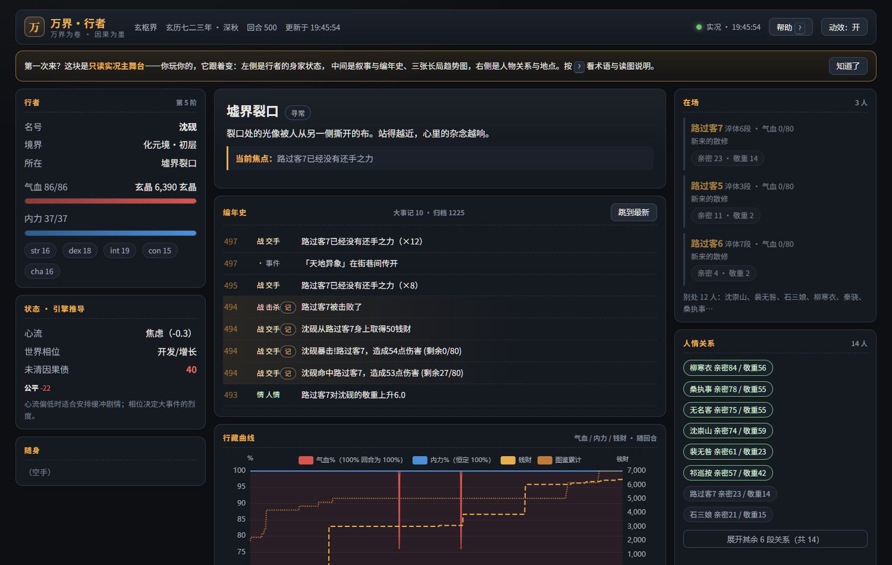
</p>

<p align="center">
  <a href="docs/screenshots/walkthrough.mp4">▶ Watch the 16-second real interaction recording</a>
</p>

---

## Why this exists

Most AI text games hand the "world" to a language model: numbers drift, NPCs forget,
the same choice gives a different outcome on replay. **World Walker inverts that**:

- **The engine does the math** — hits, damage, prices, relationships, karma, faction power,
  rumor spread are all resolved by deterministic rule functions.
- **The agent writes the prose** — the LLM only turns returned JSON into literary text;
  it must not invent numbers.
- **The panel bears witness** — a read-only web stage shows the real state, so every number
  on screen is checkable.

It is not another "AI GM prompt". It is a **world kernel any agent can call**: an MCP server (stdio),
a CLI (14 commands), and an HTTP read-only panel sharing one rule set and one state file.

---

## Quick start (30 seconds)

```bash
pip install -e ".[mcp]"          # stdlib only + optional mcp SDK
```

Add to any MCP client (Claude Code / Codex / Cursor / opencode):

```json
{ "mcpServers": { "world-walker": { "command": "world-walker-mcp" } } }
```

The relative bundle path below works from a repo checkout; after `pip install` the bundles
live inside the package and `load_setting` falls back to that location automatically.

Then tell your agent:

```
load_setting(path="settings/玄枢界.setting.json")
```

That boots a full game. Every action is then settled by tools:

```
You: I walk into the Wanshi trading house and put the torn page on the counter.
Agent → trade(location="临川城", item="ningyuan_dan", direction="buy", quantity=1)
      → social(actor="player", target="shi_sanniang", event="cooperate")
      → narration_context(...)  →  publish_prose(...)  →  tick()
```

No MCP? The CLI works too:

```bash
python init_game.py
python engine.py world_state --state game_state.json
python engine.py combat --state game_state.json --attacker player --defender goblin --action_type heavy
python panel.py --state game_state.json
```

---

## Screens

Every screenshot is a **real render of a real save**, asserted element-by-element in Edge by
`scripts/shots.py`. Source saves live in [`docs/demo/`](docs/demo/).

| Xuanshu (Eastern fantasy · ink-gold) | Zhejian (Wuxia · ink) |
|---|---|
|  | 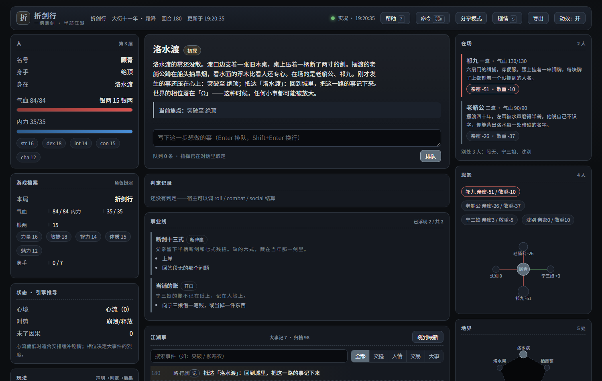 |
| **Neon Abyss (cyberpunk · neon)** | **Fogport (investigation · graphite)** |
| 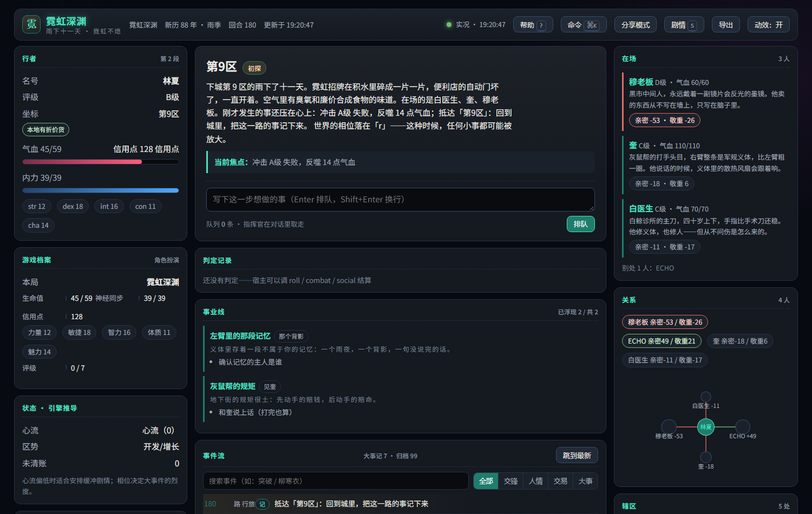 | 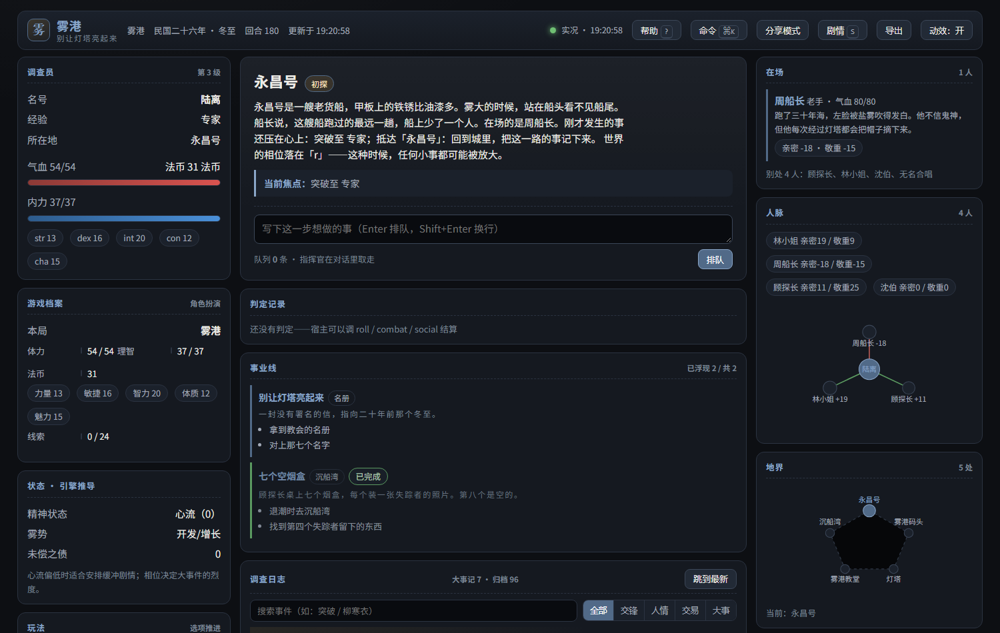 |

Skins are the surface. What actually changes with the world is **vocabulary, tiers, currency and
place descriptions**: a setting bundle can write `terms: { level: "身手", gold: "银两" }` and the panel
will never show "境界 / 灵石" again. `scripts/verify_settings.py` asserts this for every bundle.

| | |
|---|---|
| 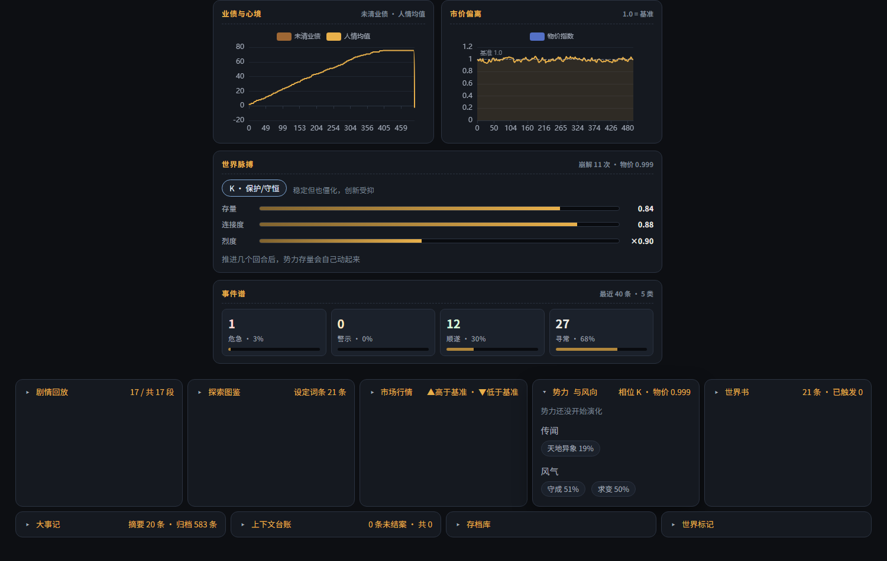 | 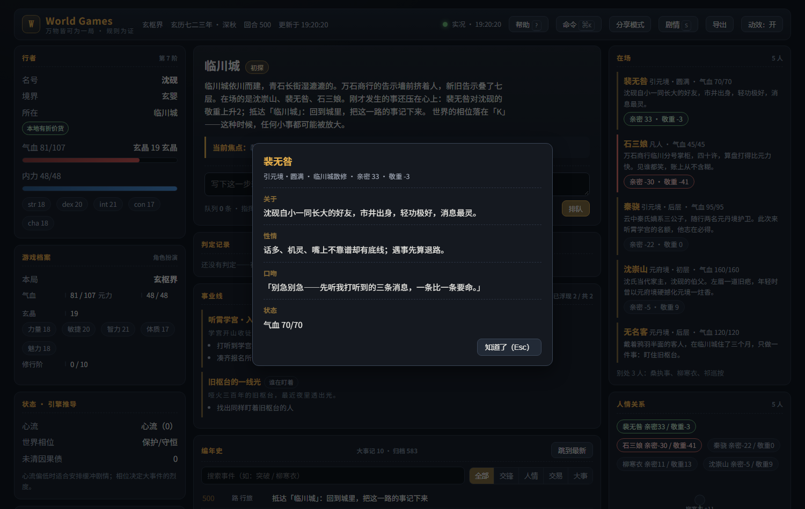 |
| **World pulse**: Panarchy phase, faction power, connectedness, intensity, rumors — advanced every `tick` | **Character card**: click anyone on stage to read their card text |
| 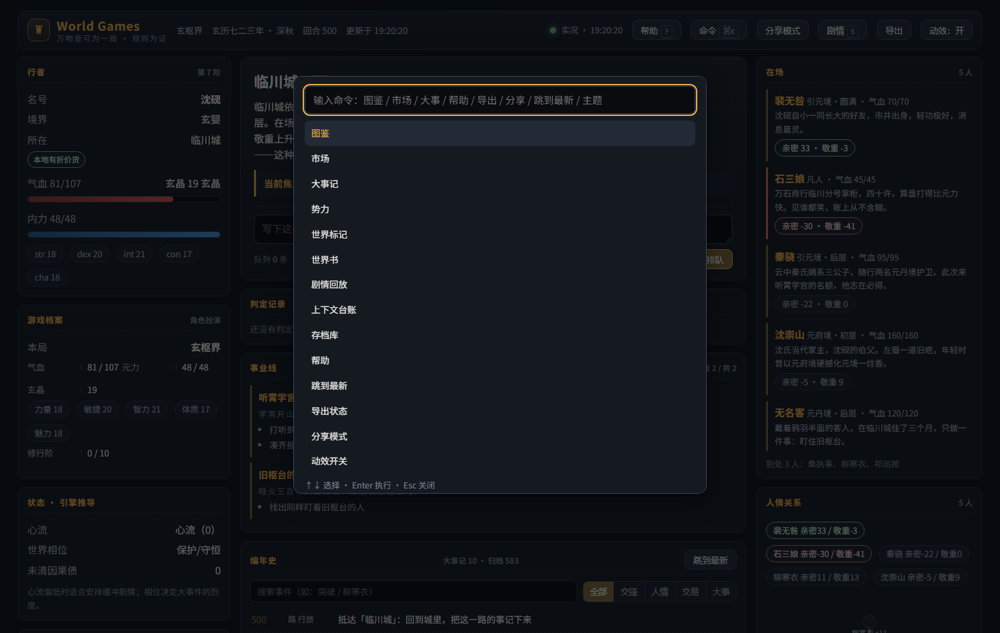 | 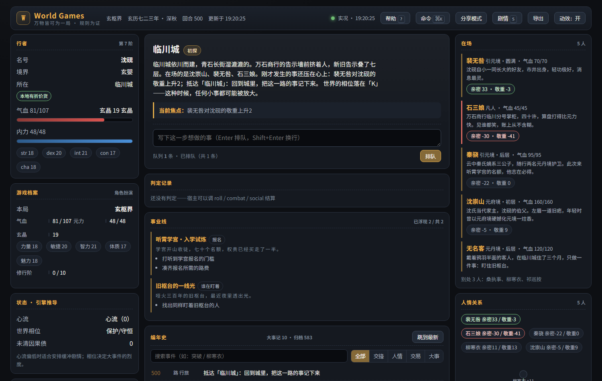 |
| **Command palette** (`Ctrl/⌘+K`), fully keyboard reachable | **Action queue**: queue actions in the browser; the agent drains them via `pending_actions` |

| Codex | Market | Milestones |
|---|---|---|
| 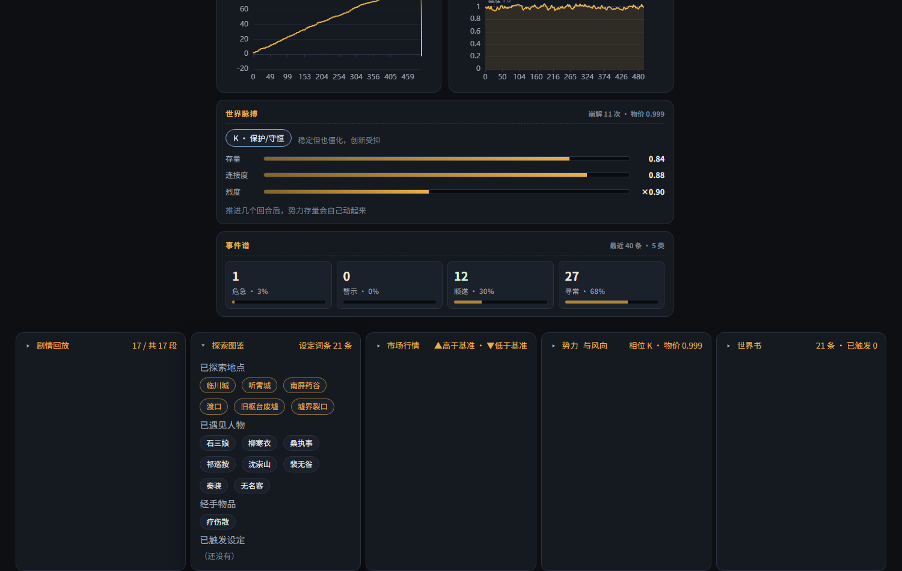 | 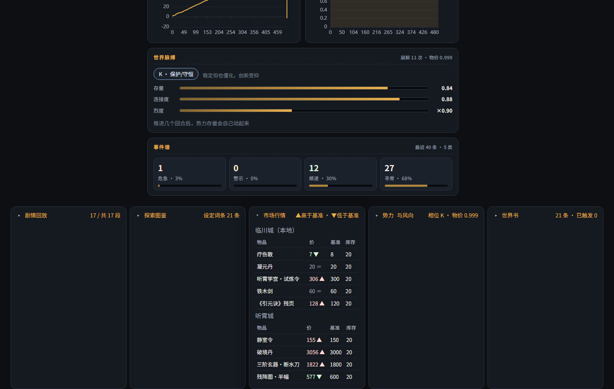 | 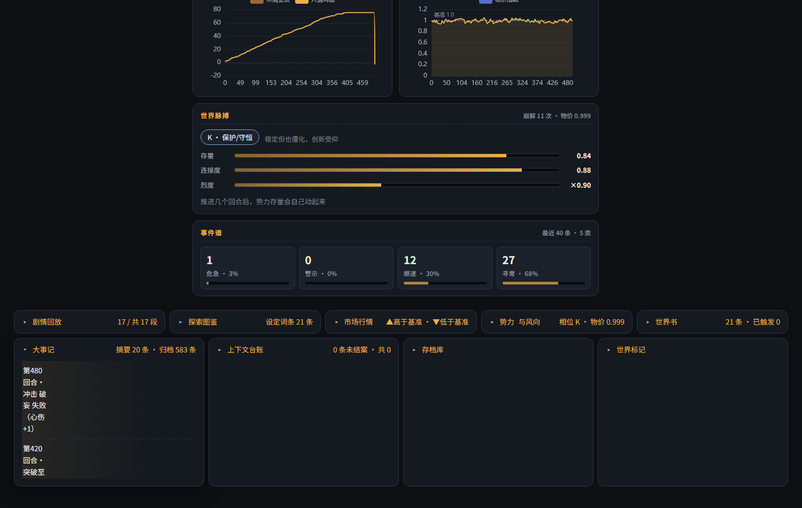 |

| 768px | 320px | Help |
|---|---|---|
| 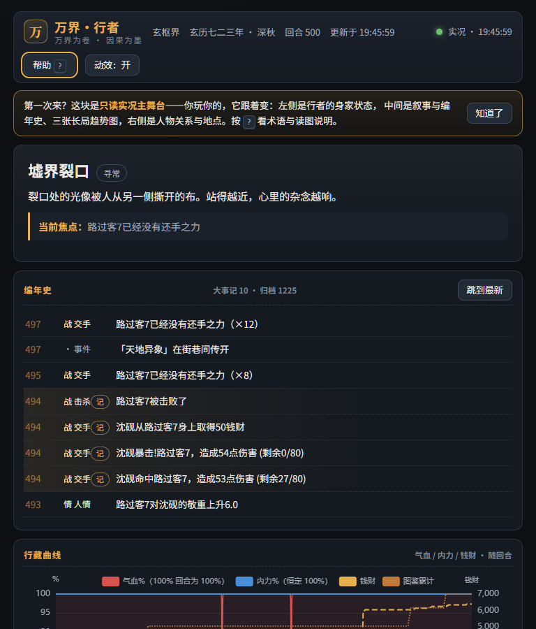 | 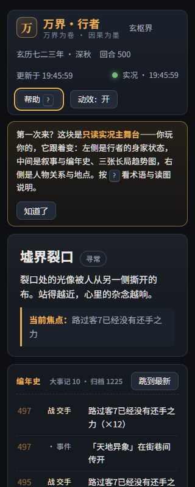 | 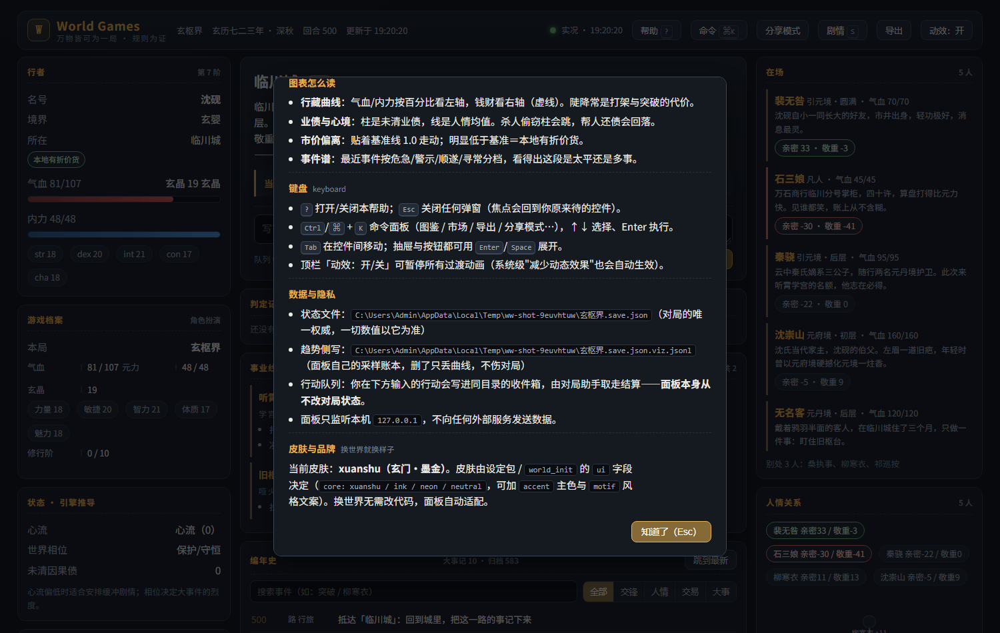 |

| Share mode (hides paths & controls) | First-visit guide |
|---|---|
| 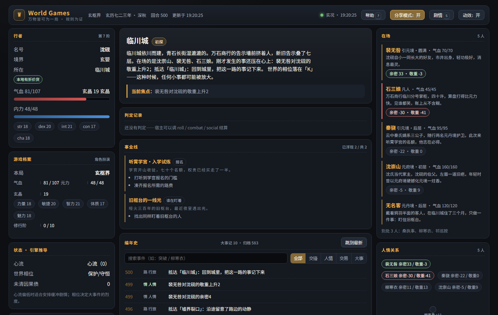 | 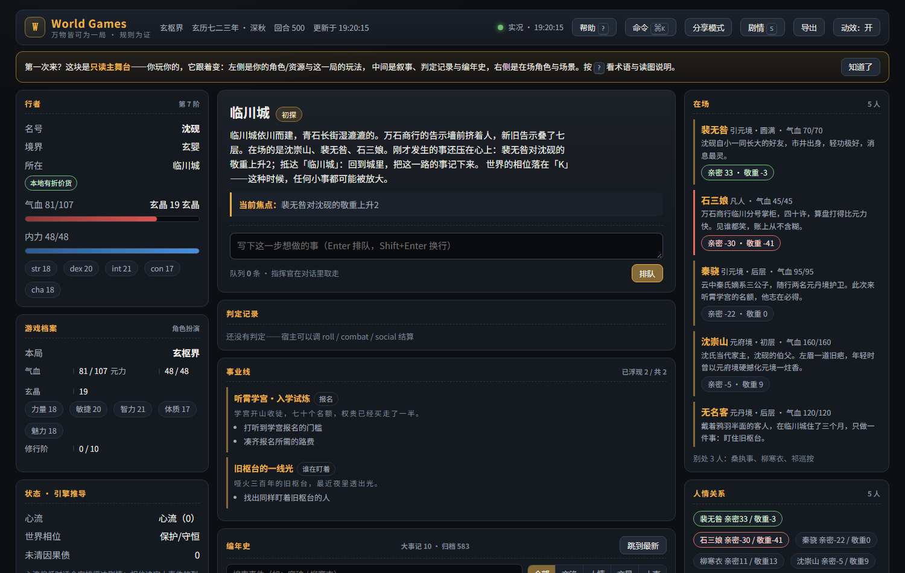 |

---

## How it compares

Full method and evidence: **[docs/BENCHMARK.md](docs/BENCHMARK.md)**. One-line version:

| Dimension | Typical (AI Dungeon / NovelAI / SillyTavern) | This project |
|---|---|---|
| Who decides numbers | The LLM, in prose | **Rule functions**, byte-identical replay per seed |
| Does the world move on its own | No (waits for input) | **`tick` advances** factions / rumors / culture / NPCs / Panarchy |
| Swapping worlds | Prompt + character card | **Setting bundle**: terms, tiers, currency, places, lorebook, brand, skin |
| Long-game memory | Context window + summary | **Three layers**: summaries + milestones + generational archive (`recall`) |
| Ecosystem | Proprietary | Reads SillyTavern **character cards** (PNG/JSON, V1–V3) and **world info** |
| Interface | Chat stream | **Read-only live stage**: narrative + HUD + long-run charts + codex + market |
| Auditable | Hard | Structured event fields; read-only tools never write; mutation suite 36/36 |

We deliberately **do not** do: image generation, multiplayer, cloud accounts, plugin marketplaces.
Reasons are in [ROADMAP.md](ROADMAP.md).

---

## Core mechanics (all on the settlement path)

### 1. The world moves by itself

Each `tick` advances:

- **Factions** — logistic growth toward a per-faction endowment cap (deterministically derived from the name),
  mild Lotka–Volterra pressure between the top two, plus challenger backflow.
  Long-term hierarchy, short-term turnover.
- **Rumors** — one SIR step; new rumors seed only on high karma, price anomalies, or violent phases.
- **Culture** — Deffuant bounded confidence, evaluated every 10 turns.
- **NPCs** — entities tagged `roam: true` change locations.
- **Panarchy** — an explicit `r → K → Ω → α → r` state machine driven by real stock
  (faction mean, relation density, world flags, karma, price deviation), not a lookup table.

`verify_world.py` (W1/W2/W11) asserts all four actually happen, including through the real MCP `tick` tool.

### 2. Derived metrics feed settlement

| Metric | Where it acts | Test |
|---|---|---|
| World phase | Ω: event probability ×1.6, damage ×1.25, hit ×0.90 | W3 |
| Flow | boredom lowers hit chance, anxiety raises it | W4 |
| Six-axis morality | accumulated from karma type (not parsed from Chinese text); infamy dampens social gains | W5 |
| Level tiers | combat power bonus per tier; `advance` enforces step-by-step progression | W10 |

### 3. Karma ledger

Structured entries: type, amount, creditor, turn, settled. Unsettled debt lowers breakthrough odds,
amplifies hostility, and raises "tribulation" severity. The ledger is bounded by **merging** the oldest
entries while preserving the total—never truncating.

### 4. Long-game memory

```
write_summary  every 20–50 turns: three to five sentences about what changed
milestones     breakthroughs / kills / first arrivals / karma escalations
archive        overflow events appended to <state>.log.jsonl
recall         keyword recall across archive generations
recap          budgeted bundle: latest summary + milestones + recent events
```

`snapshot` / `restore` only switch archive generations—they **never delete written history**.

### 5. Reproducibility

- Every game carries a `seed`.
- Each settlement reseeds from `sha256(seed, tick, counter)`; `rng_counter` is persisted.
- World evolution derives randomness from `sha256(seed|tick|key)` and does **not** consume `rng_counter`.
- Read-only tools (`status` / `world_state` / `read_state`) **never write and never advance the counter**.

Locked by `verify_cli.py` (CLI channel), `verify_mcp_stdio.py` (MCP channel) and `verify_world.py` (world evolution).

---

## MCP tools (39)

| Group | Tools |
|---|---|
| Setup | `world_schema` `world_init` `world_open` `load_setting` |
| Gameplay | `playbook_info` `quest_status` `quest_advance` `failure_tick` |
| Lorebook | `lore_lookup` |
| Settlement | `combat` `trade` `social` `karma` `tick` `use_item` `advance` |
| Narrative | `narration_context` `publish_prose` `narrative` `narrative_weight` `merit` |
| Long game | `write_summary` `recap` `recall` `snapshot` `restore` `configure` |
| World | `read_state` `world_state` `status` |
| Ecosystem | `character_card_read` `add_character` `import_lorebook` `spawn_npc` |
| Models | `model` `model_list` (16 named closed-form models) |
| Panel | `open_panel` `pending_actions` |
| Movement | `travel` |

See [GAME_MASTER_PROTOCOL.md](GAME_MASTER_PROTOCOL.md).

---

## Gameplay layer: same rules, four ways to play

World-swapping is only the first layer. What actually decides *how this game plays* is the `playbook`:

| Field | Values | Effect |
|---|---|---|
| `loop` | `freeform` / `choice` / `mud` / `ttrpg` | narrative loop: free input / options / location commands / declare→resolve→consequence |
| `input` | `natural` / `choice` / `command` | player input form |
| `progress` | `{axis, label, max}` | progress axis: `level` / `gold` / `reputation` / `knowledge` / `clock` |
| `failure` | `{mode, label, max}` | failure condition: `hp` / `sanity` / `clock` / `deadline` / `none` |
| `beat` | `{pattern, every}` | beat sequence (e.g. daily · friction · escalation · cost · payoff) |
| `settlement` | tool names | which settlements this run allows |
| `context` | `{inject, max_lore, scan_depth}` | per-turn context injection policy |

`playbook_info` returns the current playbook, progress, failure clock, current beat and a **narration guide**
for the host; `scripts/verify_gameplay.py` (60 assertions) locks these semantics.
The four setting bundles demonstrate the four loops: xuanshu `freeform` / wuxia `ttrpg` / cyberpunk `mud` / mystery `choice`.

## Questlines: objectives and pressure, never a chore list

A bundle's `questlines` is a stage DAG:

```json
{
  "id": "fog_lighthouse",
  "title": "Keep the lighthouse dark",
  "visibility": {"flag": "unsigned_letter"},
  "stages": [
    {"id": "letter", "title": "The letter", "objectives": ["find out who wrote it"],
     "exit_if": {"visited": "fog_harbor"}, "next": ["keeper"]},
    {"id": "keeper", "title": "The keeper", "objectives": ["find old Shen"], "next": []}
  ],
  "reward": {"flags": ["lighthouse_truth"]}
}
```

- **Predicates read world state only**: `flag` / `visited` / `gold_gte` / `karma_gte` / `tier_gte` / `relation_gte` / `item_gte` / `counter_gte` / `stage_done`, composable with `all` / `any` / `not`.
- **dormant is hidden**: quests whose `visibility` is unmet do not take up panel space.
- **Only `exit_if` advances**: a stage without `exit_if` never advances automatically — the host calls `quest_advance`.
- **Failure wins**: `fail_if` or `deadline_tick` short-circuits any progress.
- **Rewards pay once**: repeated ticks after completion cannot pay again.
- Loading validates the DAG: cycles and dangling `next` are rejected.

## Lorebook: tavern semantics, deterministic per tick

| Semantics | Status |
|---|---|
| `keys` / `secondary_keys` / `selective` | supported |
| `selectiveLogic` (AND_ANY / NOT_ALL / NOT_ANY / AND_ALL) | supported |
| `constant` / `insertion_order` / `enabled` | supported |
| `probability` / `use_probability` | supported (derived from `sha256(seed|tick|entry)`) |
| `sticky` / `cooldown` / `delay` | supported (tick-based, persisted in state) |
| `group` / `group_weight` / `group_override` | supported (one entry per group) |
| `scan_depth` / `match_whole_words` / `exclude_recursion` | supported |
| Recursive scanning | supported but **off by default** |
| `position` / `depth` / `role` / `outlet` | not supported: prompt layout belongs to the host |
| `vectorized` / `automationId` / `characters` filters | not supported: needs embeddings or front-end scripts |

The panel's lorebook drawer shows trigger counts and remaining sticky/cooldown per entry.
`lore_lookup` previews a trigger for arbitrary text.

## Setting bundles: swap worlds without code

| Bundle | Genre | Highlights |
|---|---|---|
| [`玄枢界`](settings/玄枢界.setting.json) | Eastern fantasy | ten cultivation tiers, crystal economy, eight factions, 21 lorebook entries |
| [`折剑行`](settings/折剑行.setting.json) | Wuxia | seven martial tiers, broken-sword main line, pawnshop economy |
| [`霓虹深渊`](settings/霓虹深渊.setting.json) | Cyberpunk | F–S ratings, credits, cyberware and memory, endless rain |
| [`雾港`](settings/雾港.setting.json) | Investigation | six investigator tiers, sanity/stamina, lighthouse mystery |

Format: [settings/README.md](settings/README.md).

---

## Quality

No pytest suite by design—verification is 14 executable self-checks plus a mutation suite
(assertions must be *killable*, not merely *covered*).

| Suite | Assertions | Locks |
|---|---|---|
| `verify_formulas.py` | 122 | recompute 77 functions from their docstring math |
| `verify_branches.py` | 191 | exception paths and state branches of low-coverage modules |
| `verify_cli.py` | 21 | read-only invariants, write effects, cross-channel determinism, CLI tick drives the world |
| `verify_panel.py` | 72 | view-model contract, legacy saves, static whitelist, inbox guards |
| `verify_mcp_stdio.py` | 64 | real stdio e2e, tavern ecosystem, read-only zero side effects |
| `verify_world.py` | 48 | self-evolution, phase, flow, morality, terms, prose, ledger |
| `verify_settings.py` | 17 | all four bundles load and evolve (zero-dependency path) |
| `verify_docs.py` | 16 | version single-source / tool count / asset references |
| `verify_gameplay.py` | 60 | playbook loops, questline DAG, lorebook semantics |
| `verify_injection.py` | 21 | injection signatures and `untrusted` marking |
| `verify_near_death.py` | 7 | near-death protection |
| `verify_memory.py` | 7 | leak check + three bounded structures |
| `user_playtest.py` | 47 | player-perspective abuse cases and error readability |
| `smoke_ui.py` | 13 | real Edge render, drawers, responsive, zero JS errors |
| `verify_tests.py` | 629 audits | AST-level rejection of tautological assertions |
| `verify_mutation.py` | 36 mutants | **break the code, require tests to go red**; survival must be 0% |

```bash
bash scripts/pre_push_gate.sh     # 22 checks, same criteria as GitHub Actions
```

Coverage gate: core ≥70% (currently 88%); pyflakes = 0. bandit is clean on the engine core; the repository-wide scan still reports findings confined to test scripts.

---

## License

MIT. Charts by [ECharts](https://echarts.apache.org/) 5.5.1 (Apache-2.0).
Tavern-ecosystem compatibility follows the publicly documented character-card / world-info conventions;
no names or settings from existing works are reused.
