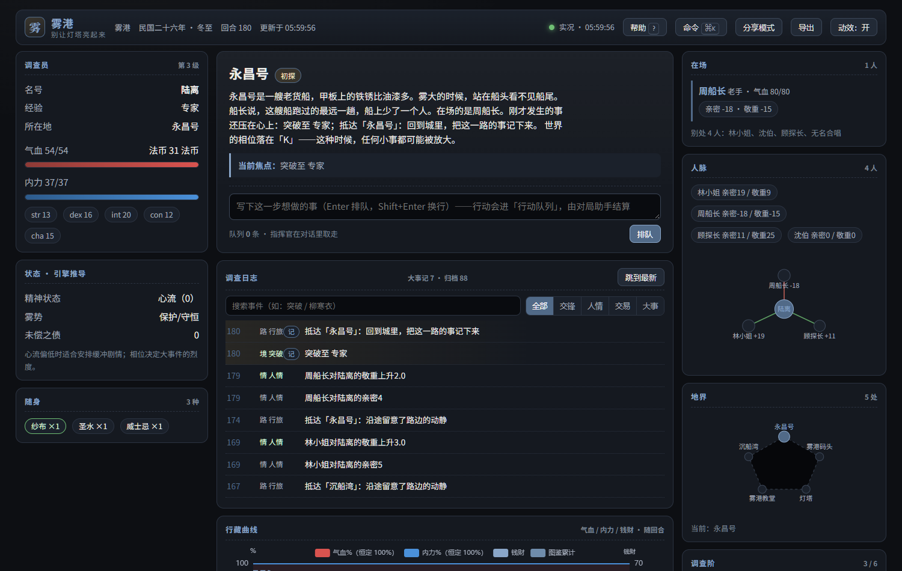
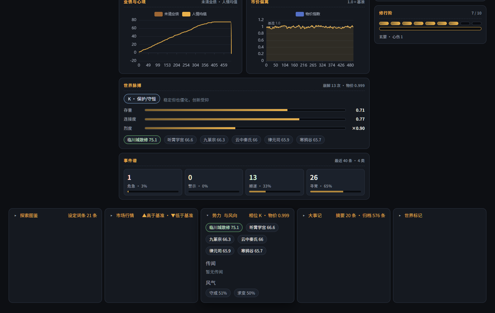
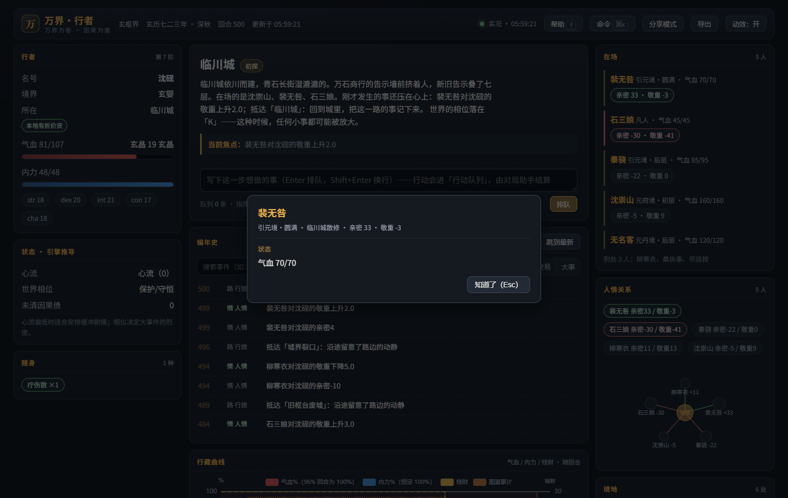
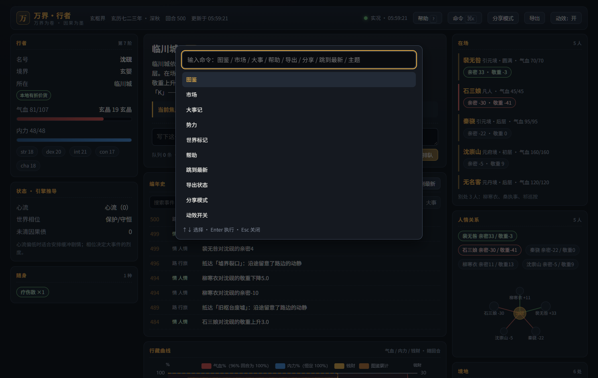
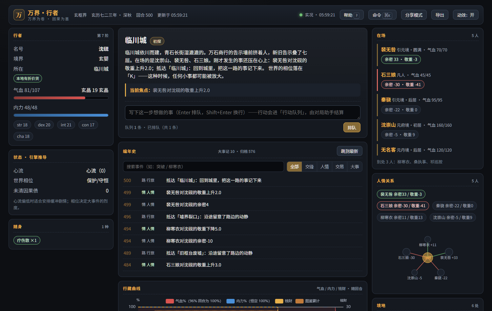

# 万界 · 行者

**版本 v1.0.0** · **中文** | [English](README.en.md) · [架构](ARCHITECTURE.md) · [对标调研](docs/BENCHMARK.md) · [更新日志](CHANGELOG.md) · [展示站](https://badhope.github.io/world-walker/)

> **AI 负责叙述，引擎负责世界。**
> 世界观无关的文字互动游戏内核：144 个规则函数、34 个 MCP 工具、4 套可直接开玩的设定包、
> 一块离线可用的只读实况主舞台。同一份存档、同一个种子，永远得到同一个世界。

<p align="center">
  
</p>

<p align="center">
  <a href="docs/screenshots/walkthrough.mp4">▶ 观看 12 秒真实交互录屏（行动排队 / 时间线筛选 / 命令面板 / 角色卡）</a>
</p>

---

## 这是什么

大多数 AI 文字游戏把"世界"交给语言模型即兴发挥：数值会漂移、NPC 会失忆、
同一个选择重开一次结果不同。**万界·行者把这件事反过来**：

- **引擎算数**：命中、伤害、价格、关系、因果、势力消长、谣言扩散，全部由确定性规则函数结算；
- **Agent 作文**：语言模型只把你看到的 JSON 转写成文学描写，不得编造数值；
- **面板见证**：一块只读网页主舞台实时显示真实状态——它不能改对局，因此它显示的每个数字都可核对。

它不是又一个"AI 跑团提示词"，而是一层**可以被任何 Agent 调用的世界内核**：
MCP 服务器（stdio）、命令行（14 条命令）、HTTP 只读面板，三条通道共用同一套规则与同一份状态文件。

---

## 三十秒上手

```bash
pip install -e ".[mcp]"          # 仅标准库 + 可选 mcp SDK
```

把下面这段加进任意 MCP 客户端（Claude Code / Codex / Cursor / opencode）：

```json
{ "mcpServers": { "world-walker": { "command": "world-walker-mcp" } } }
```

然后对 Agent 说一句：

```
load_setting(path="settings/玄枢界.setting.json")
```

一局就开好了。接下来每个行动都由工具结算：

```
你：我走进万石商行，把《引元诀》残页拍在柜台上，问石三娘这东西值多少。
Agent → trade(location="临川城", item="yinyuan_canye", direction="sell", quantity=1)
      → social(actor="player", target="shi_sanniang", event="cooperate")
      → narration_context(...)  →  publish_prose(...)  →  tick()
```

不想装 MCP 也能玩命令行：

```bash
python init_game.py                       # 生成示例世界
python engine.py world_state --state game_state.json
python engine.py combat --state game_state.json --attacker player --defender goblin --action_type heavy
python panel.py --state game_state.json   # 打开只读主舞台
```

---

## 界面

全部截图来自**真实对局的真实状态**，由 `scripts/shots.py` 在 Edge 中逐项断言后现场拍摄
（来源存档见 [`docs/demo/`](docs/demo/)，重拍命令见文末）。

### 四套世界观，同一套引擎

| 玄枢界（东方玄幻 · 墨金） | 折剑行（武侠 · 水墨） |
|---|---|
|  |  |
| **霓虹深渊（赛博朋克 · 霓虹）** | **雾港（调查悬疑 · 石墨）** |
|  |  |

皮肤只是表层。真正随世界改变的是**词、阶、钱、地点描写**——设定包里写
`terms: { level: "身手", gold: "银两", track: "身手阶" }`，面板上就不会再出现"境界 / 灵石 / 修行轨"。
`scripts/verify_settings.py` 会逐个世界断言这件事。

### 主舞台能做什么

| | |
|---|---|
|  |  |
| **世界脉搏**：Panarchy 相位、势力存量、连接度、烈度、谣言热度——`tick` 每回合推动 | **角色卡**：点开在场人物，卡面文字（外观 / 性情 / 口吻）来自设定包 |
|  |  |
| **命令面板**：`Ctrl/⌘ + K`，图鉴 / 市场 / 导出 / 分享模式，全键盘可达 | **行动队列**：浏览器里排行动，经侧写文件交给 Agent 结算，状态仍只由引擎写 |

| 图鉴 | 市场 | 大事记 |
|---|---|---|
|  |  |  |

响应式与帮助：

| 768px | 320px | 帮助 |
|---|---|---|
|  |  |  |

---

## 它和别的 AI 文字游戏有什么不同

对标对象与方法（含证据链接）见 **[docs/BENCHMARK.md](docs/BENCHMARK.md)**。一句话版本：

| 维度 | 常见做法（AI Dungeon / NovelAI / SillyTavern） | 本项目 |
|---|---|---|
| 数值由谁决定 | 语言模型生成，容易漂移 | **规则函数结算**，同种子逐字节可复现 |
| 世界会不会自己动 | 通常等你行动；不行动世界静止 | **`tick` 自己推动**势力 / 谣言 / 风气 / NPC / 相位 |
| 世界观可换性 | 换的是提示词与角色卡 | 换的是**设定包**：术语、等级阶梯、货币、地点、世界书、品牌、皮肤 |
| 长局记忆 | 上下文窗口 + 摘要，旧事常丢 | **三层记忆**：摘要 + 大事记 + 逐条归档（`recall` 跨世代回捞） |
| 生态兼容 | 各自为政 | 直接吃 SillyTavern **角色卡**（PNG/JSON，V1–V3）与**世界书**（含 selective/constant/disable 语义） |
| 界面 | 聊天流为主 | **只读实况主舞台**：叙事 + HUD + 长局曲线 + 图鉴 + 市场 + 世界脉搏 |
| 可核对性 | 难以复核 | 每条事件有结构化字段；`status` / `world_state` 只读不落盘；变异测试 32/32 |

我们**不**做的事：图像生成、多人联机、云端账号体系、插件市场。
这些是取舍不是遗漏，理由写在 [ROADMAP.md](ROADMAP.md)。

---

## 核心机制（都在结算回路上，不是摆设）

### 1. 世界自己会动

每次 `tick` 都会推进：

- **势力消长**：每个势力带自己的禀赋上限（由名字确定性派生），logistic 增长 + 头部两家 Lotka-Volterra 温和压制 + 挑战者回流。长期有稳定强弱，短期有换手。
- **谣言传播**：SIR 一步。业债高、物价异常、相位剧烈时才会播种新谣言。
- **风气漂移**：Deffuant 有界信任，每 10 回合结算一次。
- **NPC 走动**：标注 `roam: true` 的 NPC 会换地点。
- **Panarchy 适应性循环**：`r → K → Ω → α → r` 四段状态机，由真实存量（势力均值、关系密度、世界标记、业债、物价偏离）驱动，不是查表。

`scripts/verify_world.py` 的 W1/W2/W11 断言这四件事真的发生：
60 回合内势力存量变化、长局里四个相位都观测到、MCP `tick` 工具本身推进世界。

### 2. 派生指标参与结算

| 指标 | 在哪里生效 | 断言 |
|---|---|---|
| 世界相位 | Ω 期事件概率 ×1.6、战斗伤害 ×1.25、命中 ×0.90 | W3 |
| 心流 | 无聊时命中下降、焦虑时上升 | W4 |
| 六维道德画像 | 业债类型直接累加（不解析中文），恶名压低社交增量 | W5 |
| 等级阶梯 | 战斗按阶给战力加成；`advance` 逐阶校验 | W10 |

### 3. 因果债

`karma` 记的是结构化账本：类型、金额、债主、回合、是否已结清。
未结清的债会压低突破成功率、放大他人敌意，并进入突破时的"天劫强度"。
台账有界：超出 `karma_ledger_keep` 时**合并**最旧条目并保留总额（不是截断）。

### 4. 长局记忆

```
write_summary  每 20–50 回合写三五句"变了什么"
milestones     突破 / 击杀 / 初次抵达 / 因果升级自动记录
archive        事件超出保留量后追加进 <state>.log.jsonl
recall         按关键词跨归档世代回捞
recap          按字符预算给出「最新摘要 + 大事记 + 最近事件」
```

回退（`snapshot` / `restore`）只切换归档世代文件，**绝不删除任何已写下的历史**。

### 5. 可复现

- 开局带 `seed`；
- 每次结算用 `sha256(seed, tick, counter)` 重置随机源，`rng_counter` 随状态落盘；
- 世界演化另用 `sha256(seed|tick|key)` 派生随机，**不消耗** `rng_counter`；
- 只读工具（`status` / `world_state` / `read_state`）**不落盘、不推进计数器**。

三条不变量由 `verify_cli.py`（CLI 通道）、`verify_mcp_stdio.py`（MCP 通道）、
`verify_world.py`（世界演化）同时锁定。

---

## MCP 工具一览（34 个）

| 组 | 工具 |
|---|---|
| 建局 | `world_schema` `world_init` `world_open` `load_setting` |
| 结算 | `combat` `trade` `social` `karma` `tick` `use_item` `advance` |
| 叙事 | `narration_context` `publish_prose` `narrative` `narrative_weight` `merit` |
| 长局 | `write_summary` `recap` `recall` `snapshot` `restore` `configure` |
| 世界 | `read_state` `world_state` `status` |
| 生态 | `character_card_read` `add_character` `import_lorebook` `spawn_npc` |
| 模型 | `model` `model_list`（16 个命名闭式模型） |
| 面板 | `open_panel` `pending_actions` |
| 移动 | `travel` |

完整参数与调用约定见 [GAME_MASTER_PROTOCOL.md](GAME_MASTER_PROTOCOL.md)。

---

## 设定包：换世界不改代码

一个 JSON 就是一个世界（[格式说明](settings/README.md)）：

| 设定包 | 类型 | 特色 |
|---|---|---|
| [`玄枢界`](settings/玄枢界.setting.json) | 东方玄幻 | 十阶修行、玄晶经济、五方势力、21 条世界书 |
| [`折剑行`](settings/折剑行.setting.json) | 武侠 | 七阶身手、断剑主线、当铺经济、克制叙事 |
| [`霓虹深渊`](settings/霓虹深渊.setting.json) | 赛博朋克 | F–S 评级、信用点、义体与记忆、雨季氛围 |
| [`雾港`](settings/雾港.setting.json) | 调查悬疑 | 六阶调查、理智/体力、灯塔谜题、克苏鲁基调 |

`scripts/verify_settings.py` 对每个包断言：载入完整、术语覆盖生效且无未声明的外来词、
货币与品牌落盘、地点描写生效、连跑 15 回合后势力与相位都在动。

---

## 质量与验证

项目没有 `pytest` 套件，验证靠 13 个可执行自检脚本 + 1 套变异测试（这是设计选择：
断言必须能被变异测试杀死，而不是只被覆盖率统计到）。

| 自检 | 断言数 | 锁住什么 |
|---|---|---|
| `verify_formulas.py` | 122 | 按 docstring 的数学式独立重算 77 个函数 |
| `verify_branches.py` | 159 | 低覆盖模块的异常路径与状态分支 |
| `verify_cli.py` | 21 | CLI 只读不变量 / 写命令业务效果 / 双通道确定性 / tick 驱动世界 |
| `verify_panel.py` | 69 | 视图模型契约 / 旧存档兼容 / 静态白名单 / 行动队列三道闸 |
| `verify_mcp_stdio.py` | 62 | 真实 stdio 通道端到端、酒馆生态、只读零副作用、面板队列 |
| `verify_world.py` | 48 | 世界自演化 / 相位 / 心流 / 道德 / 术语 / 正文 / 台账 |
| `verify_settings.py` | 17 | 四套世界观的载入与演化 |
| `verify_injection.py` | 21 | 外部文本的注入特征识别与 untrusted 标记 |
| `verify_near_death.py` | 7 | 濒死保护（气血保底、代价落盘、NPC 死亡语义不变） |
| `verify_memory.py` | 7 | 三段对照查泄漏 + 三重有界 |
| `user_playtest.py` | 47 | 玩家视角：卖没有的东西 / 超量交易 / 边界输入 / 报错可读性 |
| `smoke_ui.py` | 13 | 真实 Edge 渲染 + 抽屉 + 响应式 + 零 JS 错误 |
| `verify_tests.py` | 545 条审计 | 静态 AST：拒绝恒真/恒假/弱断言 |
| `verify_mutation.py` | 32 个变异 | **故意改坏代码，确认测试会红**；红线存活率 0% |

另有两套端到端压测：`stress_freeplay.py 500`（CI）与 `stress_freeplay.py 2000`（本机），
全程走真实 MCP stdio。最近一次 500 轮结果：0 意外错误、0 不变量破坏。

推前门禁一条命令：

```bash
bash scripts/pre_push_gate.sh     # 17 项，与 GitHub Actions 同判据
```

覆盖率门禁：核心域 ≥70%（当前实测 88%）；`bandit` High/Medium/Low 全 0；`pyflakes` 0。

---

## 项目结构

```
world-walker/                  # 仓库根即 game_engine 包
├── engine.py                  # CLI（14 条命令，命令表驱动）
├── mcp_server.py              # MCP 服务器（34 个工具）
├── state_schema.py            # 状态模型 / 原子写 / 世代归档 / 种子
├── panel.py                   # 只读视图模型 + HTTP/SSE + 行动收件箱
├── panel.html / .css / .js    # 主舞台（原生三件套，无构建链）
├── viz_series.py              # 长局态势侧写（<state>.viz.jsonl）
├── rules/                     # 144 个公开规则函数
│   ├── combat.py economy.py social.py karma.py
│   ├── cognition.py narrative_engine.py progression.py
│   ├── world_dynamics.py world_evolution.py
│   ├── models.py              # 16 个命名闭式模型
│   └── social_extended.py cultural_evolution.py systems_feedback.py
├── settings/                  # 4 套可直接开玩的设定包
├── scripts/                   # 13 个自检 + 变异测试 + 截图/视频/演示存档流水线
├── docs/demo/                 # 真实演示存档（截图与视频的数据源）
├── docs/screenshots/          # README 预览（真实渲染 + 逐项断言）
└── assets/echarts.min.js      # 离线图表库（Apache-2.0，随包分发）
```

---

## 常见问题

**它需要联网吗？**
不需要。核心与面板零第三方依赖，图表库本地随包分发。只有 MCP 模式需要装 `mcp` SDK。

**它需要 OpenAI / Claude 的 API Key 吗？**
不需要。它不调用任何模型；模型由你的 Agent 提供。引擎只负责"世界怎么变"。

**我能用它做商业项目吗？**
MIT 许可。示例设定包里的人物、势力、地名全部原创，可以自由替换。

**为什么不用 pytest？**
断言必须经得起"改坏代码看测试红不红"的检验。`verify_tests.py` 会静态拒绝恒真断言，
`verify_mutation.py` 则真的把 32 个已知错误逐个注入源码，确认每个都能被测试杀死。
两者都在门禁里。

**为什么面板不能直接提交行动？**
可以排队，但不直接结算。面板把行动写进 `<state>.inbox.jsonl` 侧写，Agent 用 `pending_actions`
取走并照常走引擎。这样"状态只有一个写入源"，确定性与快照回退语义不会被破坏。

---

## 重新生成演示素材

```bash
python scripts/make_demo.py          # 4 套世界的真实演示存档 → docs/demo/
python scripts/shots.py              # 逐项断言 + 截图 + 录屏 → docs/screenshots/
python scripts/verify_settings.py    # 四套设定包全量校验
```

---

## 许可与致谢

MIT。图表库 [ECharts](https://echarts.apache.org/) 5.5.1（Apache-2.0）。
酒馆生态格式的兼容实现参考了 SillyTavern 社区公开的角色卡与世界书规范；
本项目不复用任何作品的名词与设定。
