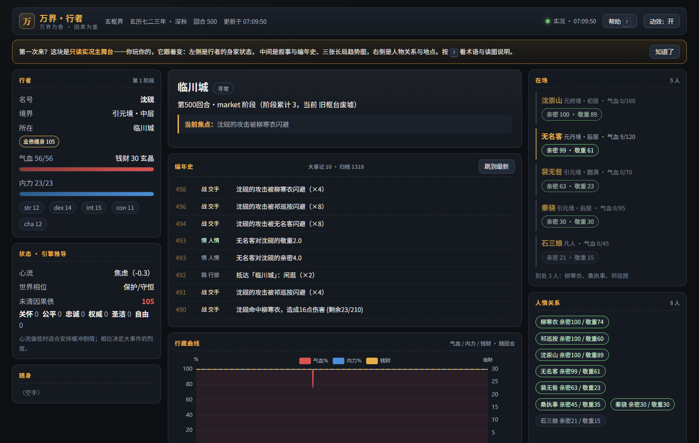
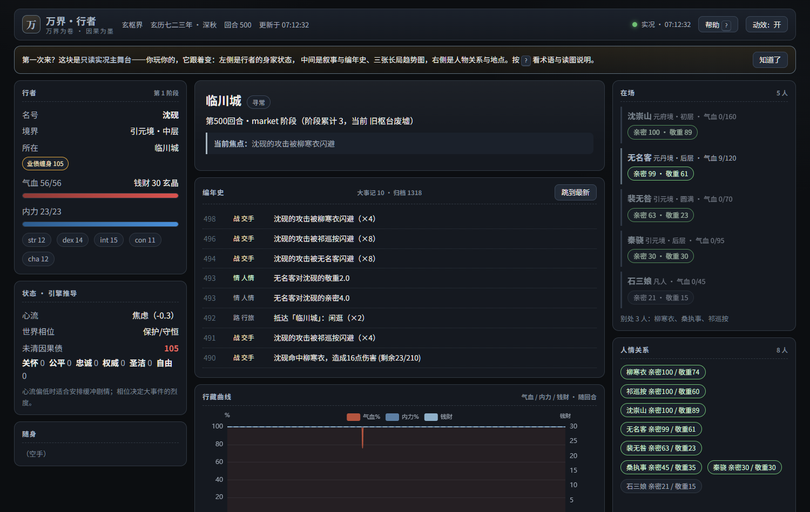
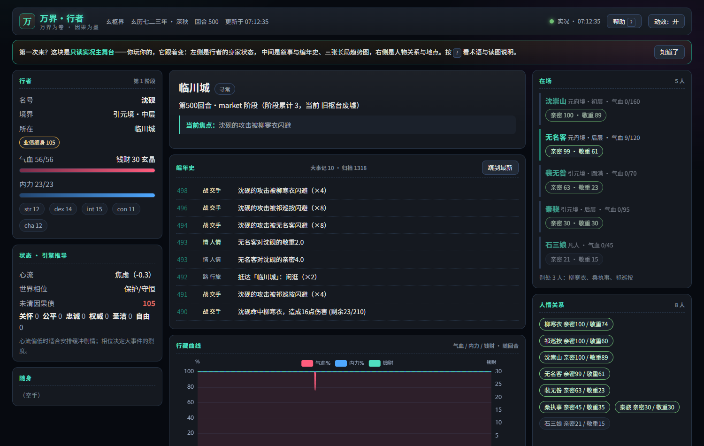
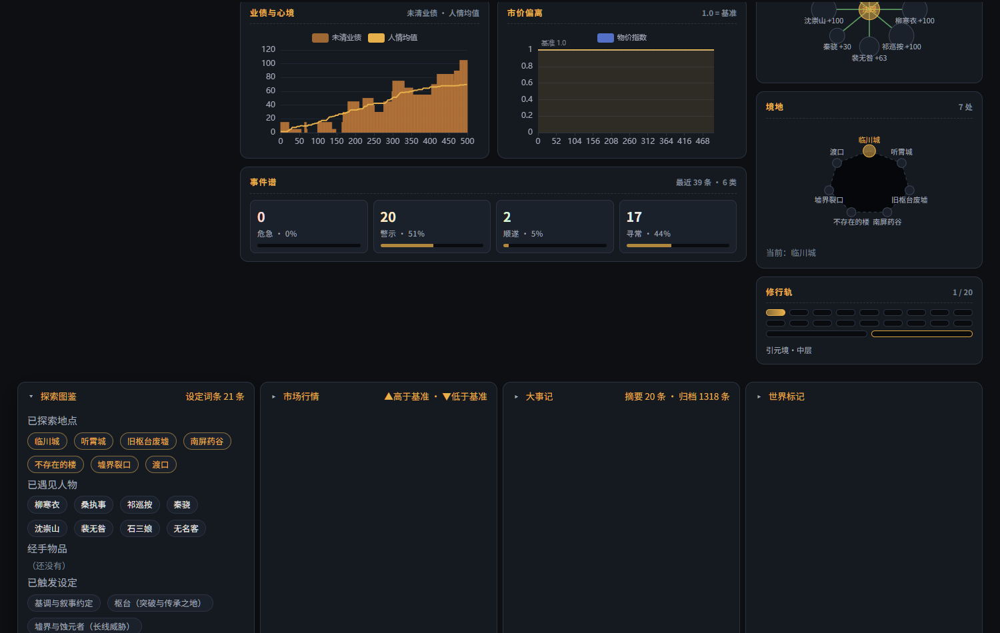
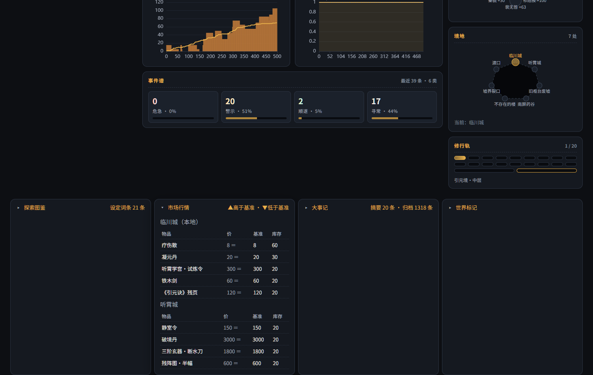
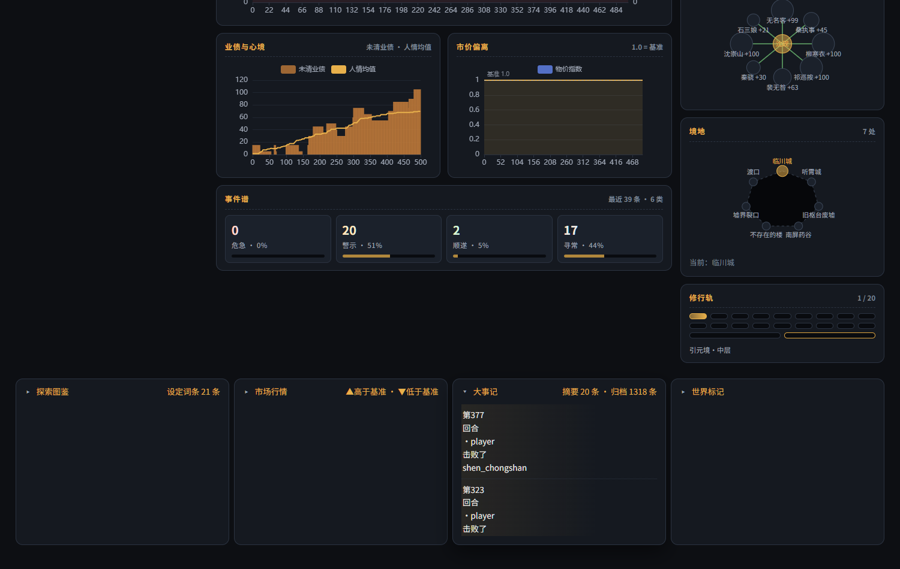
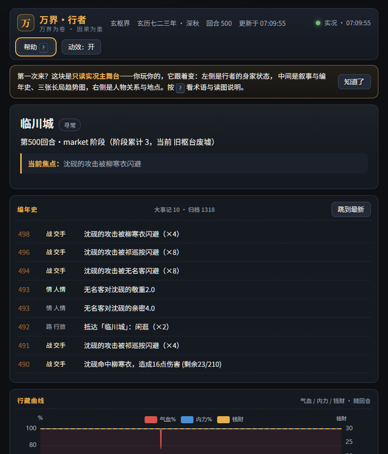
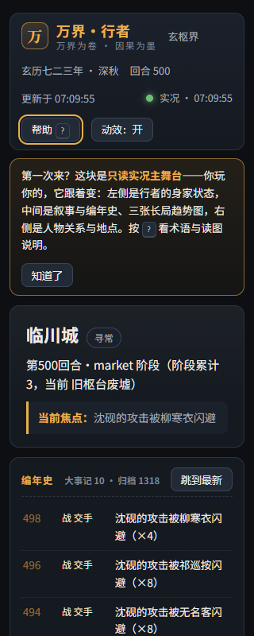
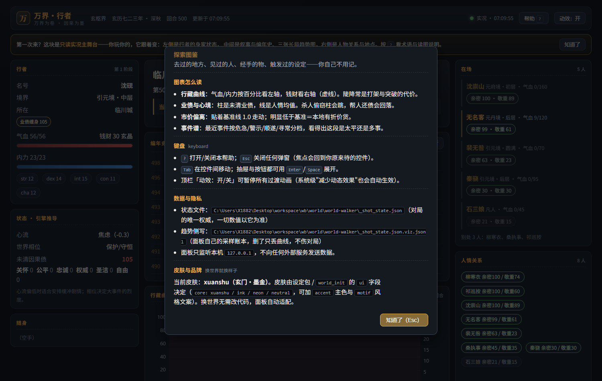
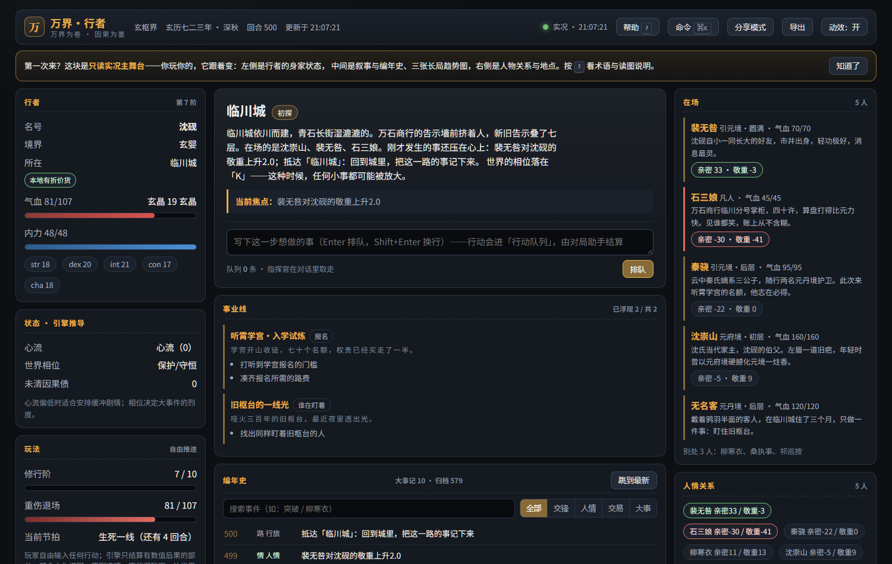

# 万界 · 行者

**中文** | [English](README.en.md)

---

**万界·行者**是一个由 AI 驱动的文字互动游戏引擎。世界的演化由 15 个学科、85+ 个学术公式驱动——玩家的每个决定通过数学模型处理，世界由此自然涌现剧情，而非预设分支。

检索关键词: `AI文字游戏` `互动小说引擎` `涌现叙事` `认知架构` `因果世界` `双系统理论` `心流` `道德基础` `文化进化` `系统动力学` `PID控制`

---

## 界面预览

实况主舞台（`open_panel` 打开）——只读、离线可用；世界观皮肤、长局曲线与事件反馈都在这一页里。
以下均为**真实渲染截图**（500 回合演示存档，非设计稿，由 `scripts/audit_ui.py` 断言 18 项后入库）：

**玄枢界（默认皮肤）**



| 水墨皮肤 | 霓虹皮肤 |
|---|---|
|  |  |

**抽屉：图鉴 / 市场 / 大事记**（展开时自动滚入视口）

| 探索图鉴 | 市场行情 | 大事记 |
|---|---|---|
|  |  |  |

**响应式与帮助**

| 768px 平板 | 320px 窄屏 | 帮助与术语表 |
|---|---|---|
|  |  |  |

首次访问会有一条一次性引导（`localStorage` 记忆，关闭后不再出现）：



> 截图取自 `scripts/stress_freeplay.py` 的自由玩家存档（回合 500 / 事件 120 / 大事记 12 / 归档 1318）。
> 每张截图前逐项断言：品牌字标、`data-skin` 与请求皮肤一致、回合号与主角名渲染、图表 canvas 尺寸有效、
> 时间线有事件、三个抽屉可展开、帮助含术语表与状态文件路径、三档视口无横向溢出、零 JS 错误、零失败请求。
> 来源与再生方式见 [`docs/screenshots/README.md`](docs/screenshots/README.md)。

---

## 快速开始

### 方式 A：MCP（推荐 —— 给任何 AI Agent 用）

```bash
pip install -e ".[mcp]"
```

在 MCP 客户端（Claude Code / Codex / Cursor / 任意支持 MCP 的 Agent）配置里加
（**本仓已带项目级 `opencode.json`，在仓库目录里 opencode 会自动接上**）：

```json
{ "mcpServers": { "world-walker": { "command": "world-walker-mcp" } } }
```

把设定丢给 Agent 即可开一局（仓库自带 `settings/玄枢界.setting.json`，`load_setting` 一句话开局）。支持 MCP prompt 的客户端还能一键开局：调 `new_game`（参数填设定），
它会生成完整开局指令。流程是：`world_init`（按设定建世界，入参带字段级说明，含 seed）→
玩家每个行动由 `combat` / `trade` / `social` / `karma` 结算 → `narration_context` 取触发的
设定条目、在场角色的卡面文字与编年史 → 文学描写 → `tick` 收回合 → 每 3-5 回合用
`narrative` + `status` 检查涌现事件与心流；Agent 只负责转写 JSON，不得编造数值。

- 生态兼容（不重复造轮子）：直接吃酒馆（SillyTavern）生态的**角色卡**（`.png` 内嵌 / `.json`，
  V1/V2/V3）与**世界书**（world-info / 卡内 `character_book`，含 selective/constant/disable 语义）；
  `character_card_read` 看卡 → `add_character` 入局（卡面文字进叙事层）→ `import_lorebook` 并入设定
- **长局支持（奔着百万回合设计）**：三层记忆，叙事永远只带该带的——
  · `write_summary` 章节摘要（宿主每 20-50 回合写一次，只写"变了什么"）
  · 大事记（突破/击杀/初次抵达/因果升级自动记录，`recap` 与面板都读它）
  · 事件自动归档：状态文件只保留最近 N 条（默认 200，`configure` 可调），
    更旧的追加进 `<状态文件>.log.jsonl`，需要时用 `recall` 按关键词回捞
  · `recap(budget_chars)` 按字符预算给「最新摘要 + 大事记 + 最近事件」
- **成长闭环**：`advance` 突破——引擎按（洞察/心境/业债/气血）判定成败并落数值后果
  （成功涨上限与属性、失败反噬气血并留心伤），杜绝手改等级
- **模型层**：`model_list` 查目录、`model(name, params)` 直接按闭式公式出数（经济 Lerner 定价/OU 价格回归、
  Cobb-Douglas、种群 logistic/Lotka-Volterra、流行病 SIR+R0、风险 Poisson 生存率、热力学松弛、舆论 bounded-confidence 等 16 个），
  宿主推导效果不再逐事件拍脑袋；市场价格每回合走 OU 均值回归
- 实况主舞台：`open_panel` 起一个**只读网页**（叙事主舞台 + 气血/内力/心流/世界相位 + 事件时间线 +
  分级弹窗/提示 + 探索图鉴/市场/大事记抽屉 + 随身物品与人物关系；状态一变自动刷新，SSE 断开自动轮询兜底）
- **长局态势可视化**：面板内三张离线图表（行藏曲线：气血/内力/钱财随回合；业债与心境；
  市价偏离基准）＋ 事件谱（危急/警示/顺遂/寻常分布）＋ 人物关系网 ＋ 地点图 ＋ 修行阶段轨 ＋
  危险/机会徽章；随回合自动累积采样（侧写 `<状态>.viz.jsonl`，不碰状态文件），玩家玩几百轮也能一眼看出趋势
- **世界观皮肤 + 品牌**：面板按世界自适应 —— 玄枢界(墨金)/水墨/霓虹/通用四套皮肤，含图表配色；
  设定包或 `world_init` 传 `ui: {skin, accent, motif, brand, tagline}` 即可让新世界自带风格与**自己的名字**
  （未知皮肤回退通用；规范见 `BRAND.md`）
- **上手帮助**：顶栏「帮助 ?」含术语表（心流/相位/因果债/物价指数…的人话解释）、图表读法、
  键盘操作、数据与隐私（状态文件/侧写文件真实路径）、皮肤说明；首次访问给一次引导条，之后不再打扰
- 使用便利：钱财等大数自动千分位、气血吃紧/业债缠身等徽章、长局人物与关系自动折叠收敛
- 错误体验：状态缺档/损坏时给可读横幅 + 重试按钮，面板不清屏也不崩
- 移动与图鉴：`travel` 是唯一能改玩家位置的工具，首次到达自动进图鉴（地点/人物/物品/已触发设定）
- 回合可回退：`snapshot` / `restore`（引擎状态确定性，回退后重放同种子一致）
- 濒死保护：玩家不会真正死亡——气血见底改判"重伤退场"，保底 1 点气血，代价是散落 30% 钱财、心伤 +1（面板显示濒死次数）；NPC 死亡不受影响
- 端到端自检：`python scripts/verify_mcp_stdio.py`（55 项断言，含酒馆生态/图鉴/面板/设定包/长局/模型层与确定性）
- 面板契约自检：`python scripts/verify_panel.py`（53 项断言：视图模型契约/旧存档兼容/静态白名单/缺档错误态/品牌/帮助/序列采样）
- 濒死保护自检：`python scripts/verify_near_death.py`（7 项断言：气血保底 1 / 代价落盘 / NPC 死亡语义不变）
- 公式对拍：`python scripts/verify_formulas.py`（122 项断言：按 docstring 的数学式独立重算 77 个函数并比对，含默认参数与边界分支）
- 模块分支补测：`python scripts/verify_branches.py`（111 项断言：systems_feedback / narrative_engine / cognition / social_extended / economy 的异常路径与状态分支）
- 界面巡检：`python scripts/smoke_ui.py`（13 项：真实 Edge 渲染 + 抽屉可展开 + 满血不误报 + 三档视口无溢出 + 零 JS 错误）
- 推送门禁：`bash scripts/pre_push_gate.sh`（14 项：编译 / 断言审计 / 五套自检 / 覆盖率 ≥70% / 压测 / 打包 / 界面）
- CLI 通道自检：`python scripts/verify_cli.py`（20 项断言：只读命令不改写状态文件/五条写命令落盘且字段有界/同种子同行动结果可复现）
- 测试可信度审计：`python scripts/verify_tests.py`（静态审计全部自检断言，拒绝恒真/恒假/弱断言——防止"测试全绿但什么都没测"）
- 用户视角试玩：`python scripts/user_playtest.py`（47 项"玩家会不会投诉"检查：卖没有的东西/超量交易/边界输入/报错可读性）
- 实测：opencode（GLM-5.2）接入后按设定建局、连续结算三个行动，叙事数值与引擎状态文件逐项一致
- 可复现：开局带 `seed`；每次结算的随机数由状态里的 `rng_seed` 与 `rng_counter` 共同决定，并随状态落盘

### 方式 B：CLI（手动结算）

```bash
python init_game.py                                      # 生成示例世界 game_state.json（青云界）
python engine.py world_state --state game_state.json      # Windows 用 python，macOS/Linux 用 python3
```

14 条命令速查（状态文件以 `game_state.json` 为例；注意 `--item` 传的是市场 item_key，不是显示名）：

```bash
python engine.py combat    --state game_state.json --attacker player --defender goblin --action_type heavy
python engine.py trade     --state game_state.json --location bamboo_tea_booth --item an_zhen_san --quantity 3 --direction buy --entity player
python engine.py social    --state game_state.json --actor player --target old_chen --event help
python engine.py karma     --state game_state.json --actor player --karma_type murder_innocent
python engine.py tick      --state game_state.json
python engine.py flow      --state game_state.json
python engine.py identity  --state game_state.json
python engine.py narrative --state game_state.json
python engine.py world_state  --state game_state.json
python engine.py panarchy  --state game_state.json
python engine.py moral_update   --state game_state.json
python engine.py cognition   --state game_state.json --entity player
python engine.py merit     --state game_state.json --aid 0.8 --sincerity 0.9
python engine.py info_weight --state game_state.json --probability 0.05
```

---

## 项目结构

```
game_engine/                      # 仓库根即 game_engine 包（导入别名已放开，目录名任意）
├── engine.py                     # CLI 入口（14 条命令）
├── mcp_server.py                 # MCP 服务器（31 个工具；除 mcp>=2 外无额外依赖）
├── state_schema.py               # 状态结构 + 辅助函数
├── init_game.py                  # 生成示例世界（青云界）
├── pyproject.toml                # pip install -e ".[mcp]"；命令 world-walker / world-walker-mcp
├── panel.py / panel.html / panel.css / panel.js   # 只读实况主舞台（视图模型 + HTTP/SSE + 前端三件套）
├── viz_series.py                 # 长局态势侧写（<状态>.viz.jsonl 采样：图表数据源，不碰状态文件）
├── assets/echarts.min.js         # 离线图表库（Apache-2.0，随包分发，无 CDN 依赖）
├── BRAND.md                      # 品牌规范（名号/标语/配色/可配置化，单一信源）
├── ARCHITECTURE.md               # 架构文档（唯一真理源：视图模型契约/不变量/ADR）
├── scripts/verify_mcp_stdio.py   # MCP 端到端自检（55 项断言，含酒馆生态兼容/图鉴/面板/模型层与确定性）
├── scripts/verify_panel.py       # 面板契约自检（53 项断言：视图模型契约/旧存档兼容/静态白名单/缺档错误态/品牌/帮助/序列采样）
├── scripts/verify_cli.py         # CLI 通道自检（20 项断言：只读不变量/写命令落盘/确定性）
├── scripts/verify_tests.py       # 测试可信度审计（AST 级：拒绝恒真/恒假/弱断言）
├── scripts/verify_near_death.py  # 濒死保护自检（气血保底/代价落盘/NPC 死亡不变）
├── scripts/verify_formulas.py    # 公式对拍（按数学式独立重算并比对 77 个函数）
├── scripts/verify_branches.py    # 模块分支补测（111 项，低覆盖模块的异常路径）
├── scripts/smoke_ui.py           # 界面巡检（真实浏览器渲染 + 交互断言）
├── scripts/audit_ui.py           # 界面截图与逐项断言（生成 docs/screenshots）
├── scripts/pre_push_gate.sh      # 推送门禁（14 项，与 CI 判据一致）
├── scripts/compile_all.py        # 跨平台全仓编译检查
├── scripts/check_wheel.py        # wheel 运行时资源校验（CI 与门禁共用）
├── scripts/user_playtest.py      # 用户视角试玩（47 项"玩家会不会投诉"检查：钻空子/边界/报错可读性）
├── scripts/stress_freeplay.py    # 自由玩家压力测试（默认 2000 回合，走真实 MCP stdio 通道）
├── docs/screenshots/             # README 预览截图（真实渲染 + 断言；来源说明见该目录 README）
├── docs/PROJECT_AUDIT_2026-10-22.md  # 全维度审查与对标报告
├── demo_state.json               # 演示状态
├── GAME_MASTER_PROTOCOL.md       # AI Agent 调用协议
└── rules/                        # 85+ 学术公式（Python 实现）
    ├── combat.py                 #    战斗 / 命中 / 暴击
    ├── economy.py                #    经济 / 供需 / 价格波动
    ├── social.py                 #    社交二维关系
    ├── karma.py                  #    因果债
    ├── cognition.py              #    认知科学（双系统、前景理论、ACT-R、心流）
    ├── world_dynamics.py         #    世界演化（混沌、进化、Panarchy、PID）
    ├── social_extended.py        #    扩展社交（Haidt、Milgram、Bandura）
    ├── cultural_evolution.py     #    文化进化（DIT、模因、文化棘轮）
    ├── systems_feedback.py       #    系统反馈（Meadows 12 杠杆点、NAT）
    └── narrative_engine.py       #    涌现叙事（Bartle、事件、相位）
```

---

## 学术覆盖

85+ 公式，15 个学科分支：

| 学科 | 核心理论 | 文件 | 行数 |
|------|---------|------|------|
| 认知科学 | Kahneman 双系统, Prospect Theory, ACT-R 记忆, Csikszentmihalyi 心流 | cognition.py | 235 |
| 混沌 / 复杂系统 | Lorenz, Lyapunov 指数, Logistic 映射, Panarchy, PID 控制 | world_dynamics.py | 275 |
| 道德心理学 | Haidt 六维, Tajfel, Bandura, Milgram, Cialdini | social_extended.py | 202 |
| 进化动力学 | Price 方程, Hamilton, ESS, Red Queen | world_dynamics.py | — |
| 文化进化 | DIT, 模因, 文化棘轮, 保真度衰减 | cultural_evolution.py | 92 |
| 系统理论 | Meadows 12 杠杆点, NAT 级联, ANT 行动者网络 | systems_feedback.py | 141 |
| 叙事学 | 涌现叙事, Bartle, 叙事传输, 空间叙事 | narrative_engine.py | 141 |
| 信息论 | Shannon 熵, KL 散度, 事件信息量 | world_dynamics.py | — |

---

## 设计原则

1. **世界观无关** —— 同一套数学，换叙事词汇即可模拟修真/武侠/奇幻/科幻
2. **涌现而非分支** —— 世界从机制中自然产生剧情，不预写分支树
3. **Agent → 引擎 → 文学** —— 引擎返回 JSON，AI Agent 负责转为文学描写
4. **完全响应式** —— 玩家想做的一切，引擎都能给一个有数学依据的结果

---

## 与他人协作

- **对玩家**: 你告诉 AI Agent 你想做什么 → Agent 调用引擎 → 引擎返回 JSON → Agent 用文字告诉你发生了什么
- **对 AI Agent**: 详见 [`GAME_MASTER_PROTOCOL.md`](GAME_MASTER_PROTOCOL.md) —— 完整的调用协议、参数说明、响应格式

---

## 许可

MIT
