# World Games

**v1.10.0** · **English** · [简体中文](README.zh-CN.md) · [Architecture](ARCHITECTURE.md) · [What it is for](docs/USE_CASES.md) · [Gameplay](docs/GAMEPLAY.md) · [Prior art](docs/PRIOR_ART.md) · [Changelog](CHANGELOG.md) · [Live site](https://badhope.github.io/world-walker/)

> **The AI narrates. The engine decides.**

Your agent writes the prose. A deterministic engine resolves every hit, price, relationship and
faction shift, then persists it to one auditable state file.

`206 rule functions` · `67 MCP tools` · `4 MCP resources` · `4 playable worlds` · `8 templates` · `0 runtime dependencies`

<p align="center">
  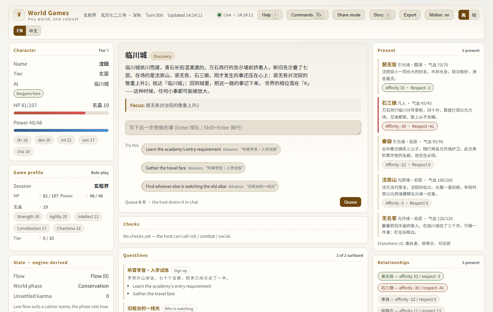
</p>

<p align="center">
  <a href="docs/screenshots/walkthrough.mp4">▶ 16-second recording of a real session</a>
</p>

<p align="center">
  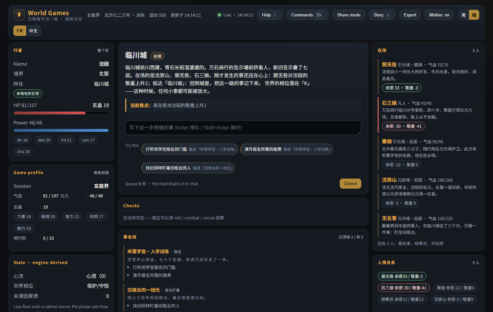
</p>

<p align="center">
  <sub><b>Light is the default</b> — the stage is read for hours. Dark is one click away in the top bar,
  and the choice is remembered. Both palettes are measured against WCAG AA by
  <code>verify_theme.py</code> in a real browser, not eyeballed.</sub>
</p>

---

## Why this exists

Three problems kill long AI-run games. Each one is solved in code, not in prompt wording.

| Problem | What usually happens | What World Games does |
|---|---|---|
| **Numbers drift** | The model invents damage, prices, HP | Rule functions resolve them; same state + seed + actions replay byte-identically |
| **The AI forgets** | Context window overflows, old facts vanish | Context ledger persists clues, promises and facts; retrieval scored like Generative Agents |
| **Saves become chaos** | One JSON file, hand-managed | Save library: multiple runs, snapshots, trash, all through `session_*` |

**Everything is replayable.** Every mutating call is logged with its arguments (hashed),
the RNG counters on both sides, and before/after state fingerprints. Same seed plus the same
action log reproduces the same world — and `verify_replay.py` proves it instead of claiming it.

Two things most frameworks skip:

- **The world moves on its own.** Every `tick` advances factions (logistic growth + Lotka–Volterra),
  rumors (SIR), culture (Deffuant), roaming NPCs and a Panarchy `r → K → Ω → α` cycle driven by real
  stock. Do not call `tick` and the world stands still — intentional, not a bug.
- **The panel is read-only, and bilingual.** English by default, one click to Chinese. It renders the
  real state and never writes. Players queue actions to a sidecar; the host drains them with
  `pending_actions`. One writer, one truth.

---

## Install

```bash
pip install -e ".[mcp]"      # core is standard library only; the mcp extra is for MCP mode
```

**No Python?** Download `world-games.exe` — one file, ~30 MB, runs standalone.
Same program, same data.

```bash
wg init my-game.json      # create a starter save
wg play --state my-game.json
```

`wg` is the single front door: `init`, `play`, `serve`, `mcp`, `run`, `doctor`, `version`.
Run `wg --help` for the full list.

### Hook it to an agent

```json
{ "mcpServers": { "world-games": { "command": "world-games-mcp" } } }
```

Works with Claude Code, Codex, Cursor, opencode, or any MCP client. `world-walker-mcp` is a
compatibility alias.

Remote agents can connect over HTTP instead of stdio:

```bash
wg mcp --http --port 8620   # then point any MCP client at http://127.0.0.1:8620/mcp
```

Then:

```
load_setting(path="settings/玄枢界.setting.json")
trade(location="临川城", item="ningyuan_dan", direction="buy", quantity=1)
```

That is a complete game: world, protagonist, NPCs, market, relations, tiers, lorebook, questline,
subsystems. The host calls tools only when a number is needed.

---

## Screens

Every image is a real render of a real save, asserted element-by-element in Edge by
`scripts/shots.py`. Source saves live in [`docs/demo/`](docs/demo/).

| Xuanshu · Eastern fantasy | Zhejian · Wuxia | Neon Abyss · Cyberpunk | Fogport · Investigation |
|---|---|---|---|
|  | 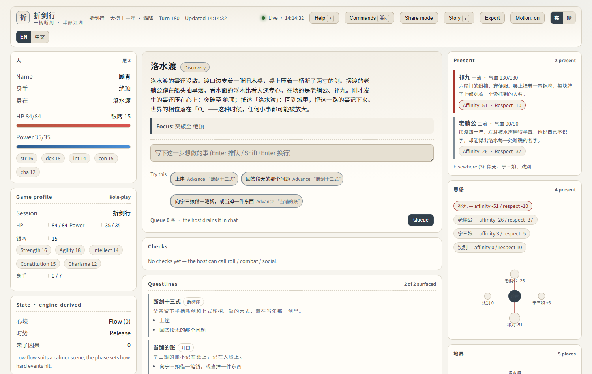 | 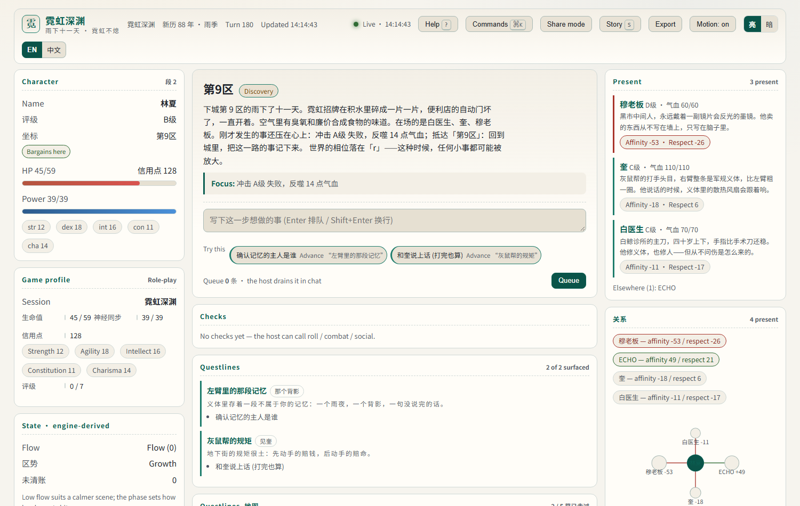 | 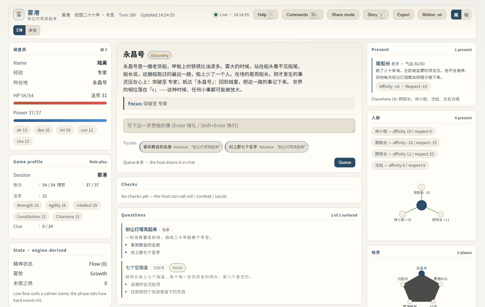 |

Skins are the surface. What actually changes per world is **vocabulary, tiers, currency and place
descriptions**: a bundle declares `terms: { level: "身手", gold: "银两" }` and the panel never shows
"境界 / 灵石" again.

| World pulse | Character card | Command palette | Action queue |
|---|---|---|---|
| 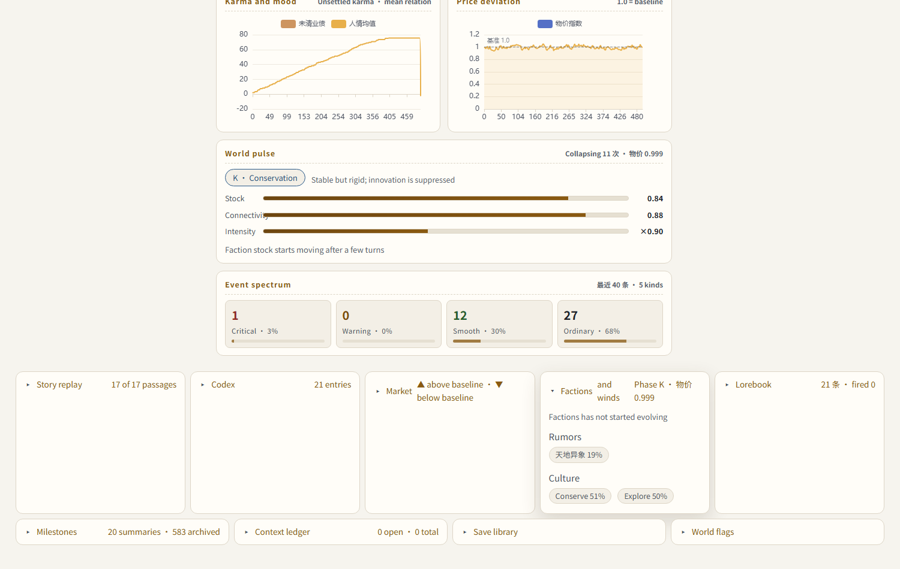 | 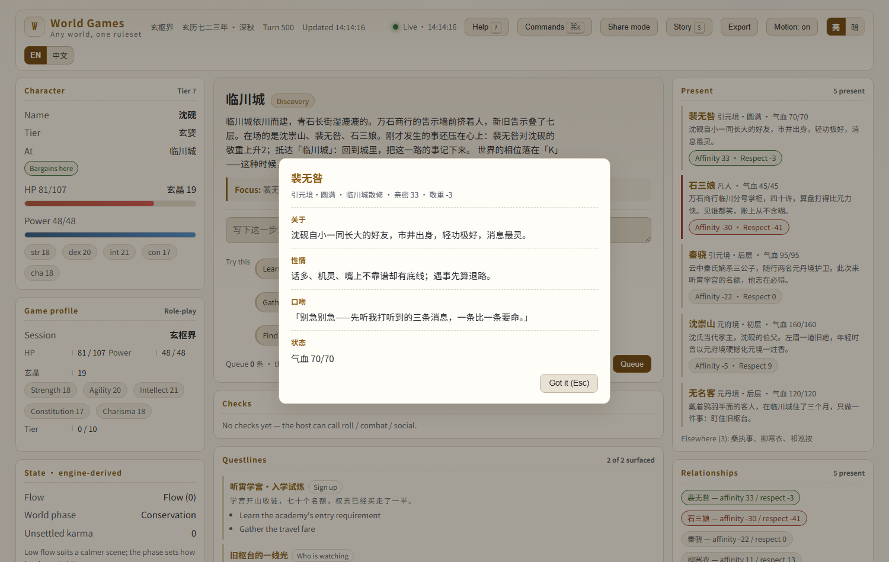 | 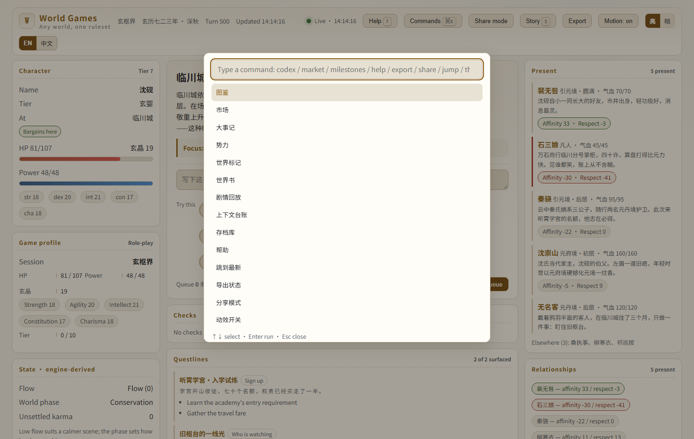 | 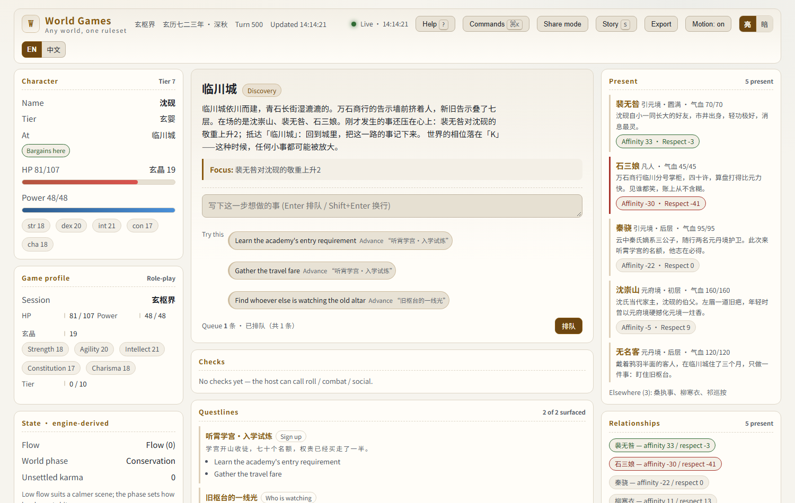 |

| Codex | Market | Milestones | Help |
|---|---|---|---|
| 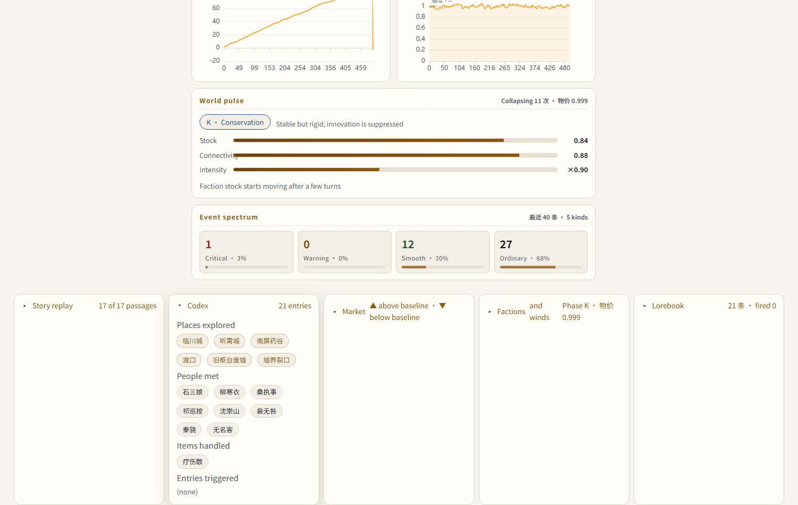 | 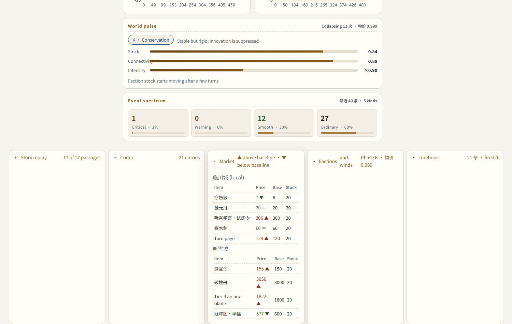 | 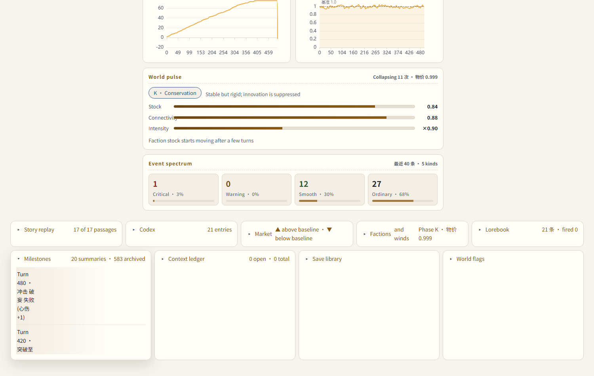 | 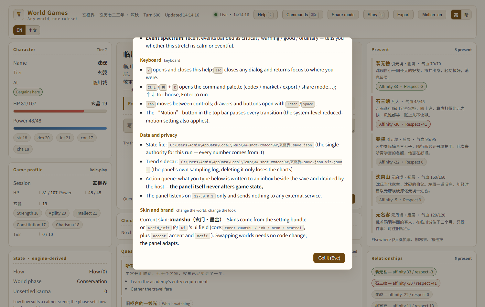 |

| 768 px | 320 px | Share mode |
|---|---|---|
| 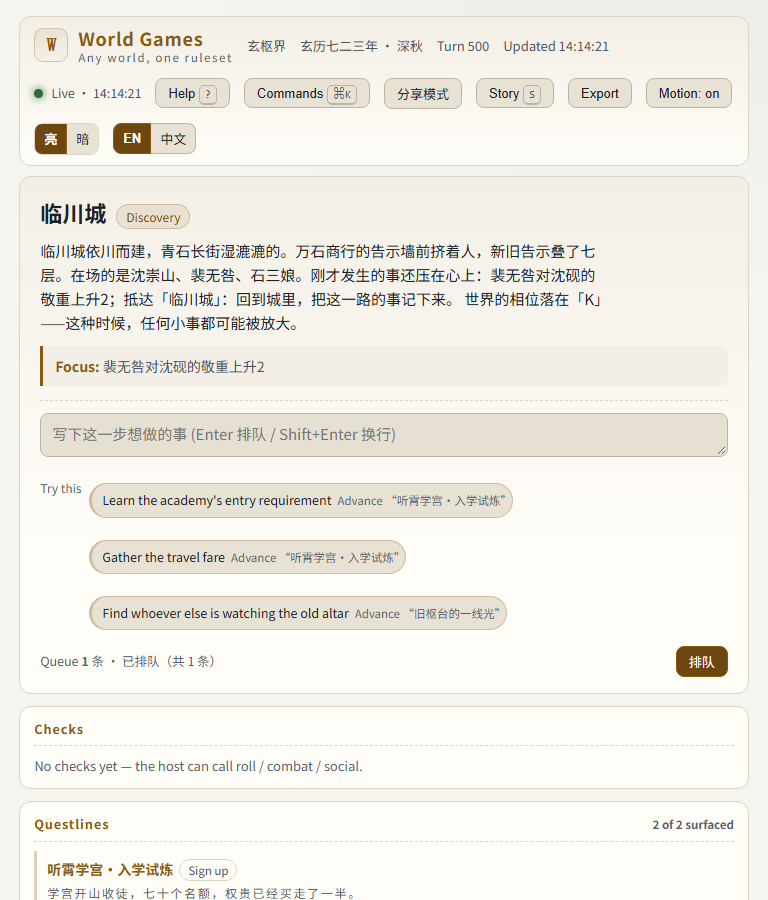 | 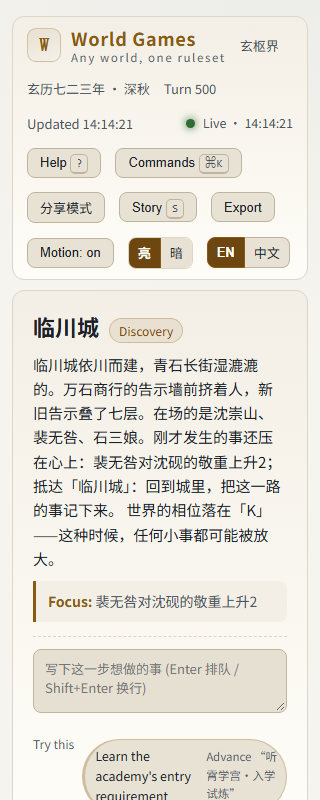 | 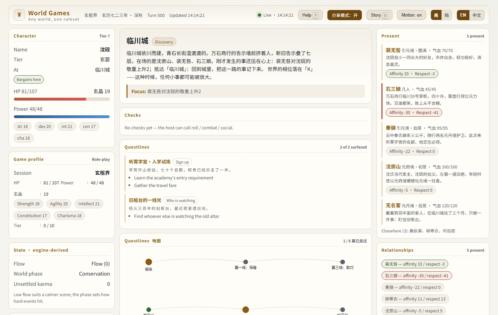 |

---

## Architecture

```
        your agent (Claude Code / Codex / Cursor / custom)
                          │  MCP over stdio
                          ▼
    ┌─────────────────────────────────────────────┐
    │  World Games MCP server                     │
    │  67 tools · 4 resources · 1 prompt          │
    │  tool annotations: read-only / destructive  │
    └───────────────┬─────────────────────────────┘
                    │  every mutation goes through
                    ▼  one transactional writer
    ┌─────────────────────────────────────────────┐
    │  rules/*  deterministic settlement          │
    │  checks · combat · economy · social · karma │
    │  questline · lorebook · systems · models    │
    └───────────────┬─────────────────────────────┘
                    ▼
            state.json  ◄── read-only ──  live stage (HTTP + SSE)
                    │                   + /admin console
                    └── generational archive (.log.jsonl)
```

**Invariants** (all asserted by the gate):

1. One writer. The panel serves `GET` only; actions queue to `<state>.inbox.jsonl`.
2. Determinism. `sha256(seed, tick, counter)` reseeds every settlement; `rng_counter` persists.
3. Everything is bounded. Event log, karma ledger, sidecar and inbox all have caps and merge rather
   than truncate.

---

## What the engine gives you

### Settlement

| Layer | What it resolves |
|---|---|
| `checks` | d20 / 2d6 / d100 / 4dF / dice pools, roll-under, opposed rolls, success bands |
| `combat` · `economy` · `social` · `karma` | hits and damage, prices, relationships, structured debt |
| `cognition` · `narrative_engine` · `progression` | flow channel, Panarchy phase, tier progression |
| `world_evolution` | factions, rumors, culture, roaming NPCs, world flags |
| `rulebook` + `loopguard` | world-specific exceptions declared by the bundle; circling detection |
| `action_log` | command-level replay with per-step state fingerprints |

### Seven pluggable subsystems

Mechanics are **data**, not code. Add or remove at runtime.

| Kind | Manages | Actions |
|---|---|---|
| `time` | day/hour, season, weather | `advance(minutes)`, `status` |
| `loot` | weighted tables, quantity ranges | `roll(table, times, grant)`, `list` |
| `craft` | recipes, material checks, skill roll | `craft(recipe)`, `list` |
| `reputation` | faction standing −100..100 with tiers | `adjust(faction, delta)`, `status` |
| `achievement` | questline predicates + rewards | `check`, `list` |
| `progression` | XP curve, levels, attribute growth | `grant(amount)`, `status` |
| `custom` | restricted effect list | `<action>`, `list` |

### Four play loops, one rule set

`freeform` (free input) · `choice` (options) · `mud` (location commands) · `ttrpg`
(declare → resolve → consequence). The loops guide the host; the engine does not enforce them.

The four bundles are the four loops: Xuanshu `freeform`, Zhejian `ttrpg`, Neon Abyss `mud`,
Fogport `choice`.

### Eight playable templates

`jrpg` · `mystery` · `management` · `survival` · `narrative` · `cozy` · `tabletop` · `immersive`

```
template_start(template="mystery", name="my case",
               overrides={"world": {"name": "Rain Harbor"}})
```

---

## The 67 tools

| Group | Tools |
|---|---|
| Setup and saves | `session_new` `session_list` `session_switch` `session_snapshot` `session_manage` `session_import` `load_setting` `world_init` `world_open` |
| Per-turn core | `pending_actions` `context_pack` `narration_context` `publish_prose` `tick` |
| Checks and numbers | `roll` `combat` `combat_preview` `trade` `social` `karma` `advance` `use_item` `game_profile` `game_adjust` `game_tag` `game_sheet` |
| World and place | `travel` `world_state` `narrative` `status` `playbook_info` `quest_status` `quest_advance` `lore_lookup` `failure_tick` |
| Memory and recall | `context_remember` `context_known` `context_tell` `context_search` `context_forget` `recall` `write_summary` `recap` `read_state` |
| Systems and templates | `templates_list` `template_info` `template_apply` `template_start` `system_define` `system_remove` `system_run` `system_status` `system_schema` |
| Ecosystem and tooling | `character_card_read` `add_character` `import_lorebook` `spawn_npc` `model` `model_list` `merit` `narrative_weight` `snapshot` `restore` `configure` `open_panel` `close_panel` `world_schema` |

Plus four **MCP resources** a host can pin into context without a tool round-trip:
`world://state/current`, `world://summary/current`, `world://settings/index`, `world://docs/protocol`.

Full parameters: [GAME_MASTER_PROTOCOL.md](GAME_MASTER_PROTOCOL.md).

---

## One turn, end to end

Real return values from the Fogport investigation bundle.

**Player:** I go to the docks and ask the gatekeeper whether the lighthouse has been lit.

```
1. context_pack(scene_text="码头 灯塔 门房")
   → playbook (choice · clues 0/24), open clues, recent events

2. roll(attribute="per", difficulty=9, dice="2d6")
   → {"rolls":[1,1], "total":2, "difficulty":9, "margin":-7, "level":"failure"}

3. context_remember("The gatekeeper says the lighthouse burned for three minutes",
                     kind="clue", keys=["lighthouse"], source="gatekeeper")
   → {"fact":{"id":"f0001", ...}, "created":true}

4. game_adjust("clue", delta=1)    → {"after":1, "at_max":false}
   game_adjust("sanity", delta=-1) → {"after":7, "at_min":false}

5. publish_prose("The rain did not stop...")
6. tick()  → one turn of world evolution
```

Everything lands in one state file: checks under `checks`, facts under `context.facts`, resources
under `game`, prose under `prose`, world under `panarchy/factions/...`.

---

## Scope

**In scope:** rule resolution, setting bundles, saves, context ledger, host narration guidance,
SillyTavern character cards (PNG/JSON, V1–V3) and world info.

**Out of scope, deliberately:** image generation, multiplayer, cloud accounts, plugin marketplace.
Reasons in [ROADMAP.md](ROADMAP.md).

---

## Quality

No pytest suite, by design. Verification is `scripts/verify_*.py` plus behaviour regressions plus
mutation testing: **an assertion must be killable, not merely covered.**

| Suite | Assertions | What it locks |
|---|---|---|
| `verify_formulas.py` | 122 | recompute 77 functions from their docstring math |
| `verify_branches.py` | 192 | exception paths and state branches of low-coverage modules |
| `verify_cli.py` | 21 | read-only invariants, write effects, cross-channel determinism |
| `verify_panel.py` | 98 | view-model contract, legacy saves, static whitelist, inbox guards, theme wiring |
| `verify_mcp_stdio.py` | 67 | real stdio e2e, HTTP transport handshake, tavern ecosystem, read-only zero side effects |
| `verify_world.py` | 54 | self-evolution, phase, flow, morality, terms, prose, ledger |
| `verify_settings.py` | 17 | all four bundles load and evolve (zero-dependency path) |
| `verify_docs.py` | — | version single source, tool count, assertion counts, asset references |
| `verify_i18n.py` | 12 | panel dictionary: unique keys, unambiguous templates, bilingual wiring |
| `verify_mechanics.py` | 39 | rulebook priority/stop, loop detection, NPC knowledge boundary, combat preview, quest DAG, visit predicates, prefix hash, rumor heat, faction intents |
| `verify_theme.py` | 25 | light-first theme, measured WCAG AA contrast in both themes, chart repaint, boot skeleton |
| `verify_replay.py` | 15 | action log chain, seq persistence, canonical hashing, deterministic fingerprint |
| `verify_gameplay.py` | 65 | playbook loops, questline DAG, lorebook semantics |
| `verify_generic.py` | 104 | generic checks, game profile, context ledger, save library, brand |
| `verify_systems.py` | 161 | seven subsystem kinds, eight templates, counters, panel contract |
| `verify_injection.py` | 23 | injection signatures and `untrusted` marking |
| `verify_near_death.py` | 7 | near-death protection |
| `verify_audit_fix.py` | 22 | snapshot restore, concurrent RMW, finite JSON, input boundaries |
| `verify_memory.py` | 7 | leak check and three bounded structures |
| `user_playtest.py` | 47 | player-perspective abuse cases and error readability |
| `smoke_ui.py` | 20 | real Edge render, cards and drawers, responsive, zero JS errors |
| `verify_tests.py` | — | AST-level rejection of tautological assertions |
| `verify_mutation.py` | 53 mutants | **break the code, require tests to go red**; survival must be 0% |

```bash
bash scripts/pre_push_gate.sh     # 32 steps; missing required dependencies fail the gate
```

Coverage gate: core domain ≥70% (measured 86%, including the generic layer); `pyflakes` 0.

---

## Project layout

```
world-walker/                  # repo root IS the game_engine package
├── cli.py                     # `wg` — the single front door
├── engine.py                  # CLI rule actions
├── mcp_server.py              # MCP server, 67 tools + 4 resources
├── mcp_primitives.py          # resources and tool annotations
├── state_schema.py            # state model / atomic write / transaction lock / archive
├── panel.py                   # read-only view model + HTTP/SSE + /admin console
├── panel.html / .css / .js    # the stage: native trio, no build chain
├── panel.i18n.js              # EN/ZH translation layer
├── sessions.py                # save library: multi-run / snapshot / trash
├── rules/                     # 206 public rule functions
│   ├── checks.py gamesystem.py context.py
│   ├── combat.py economy.py social.py karma.py
│   ├── cognition.py narrative_engine.py progression.py
│   ├── world_dynamics.py world_evolution.py
│   └── models.py              # 16 named closed-form models
├── settings/                  # 4 ready-to-play bundles
├── scripts/                   # 22 self-checks + build_exe + screenshot pipeline
└── assets/echarts.min.js      # offline chart library (Apache-2.0)
```

---

## FAQ

**Does it need network access?** No. Zero runtime dependencies; the chart library ships locally.
Only MCP mode installs the `mcp` SDK.

**Does it need an API key?** No. It never calls a model. Your agent supplies the model.

**Can I use it commercially?** MIT. Every name, faction and place in the demo bundles is original.

**Why no pytest?** Assertions must survive "break the code, watch the test go red".
`verify_tests.py` statically rejects tautological assertions; `verify_mutation.py` injects 50 real
defects and requires every one to be killed.

**Why can't the panel submit actions directly?** It can queue them, not settle them. That keeps a
single writer, which is what makes determinism and snapshot rollback trustworthy.

**Is power-loss safety guaranteed?** No, and we do not claim it. Saves use atomic replacement with
`.bak` fallback and a re-entrant Windows/POSIX lock, and crash tests cover several interruption
windows. If `<state>.archive-pending` or `.ww-session-transaction-pending` exists, protected reads
and writes are refused and there is no automatic recovery — stop writing, preserve the evidence and
review it manually. Restoring the caller's in-memory state after a failed save is
**not an archive rollback**. See [the archive recovery guide](docs/ARCHIVE_RECOVERY.md).

---

## Regenerate the demo assets

```bash
python scripts/make_demo.py          # 4 real demo saves → docs/demo/
python scripts/shots.py --lang en    # assert, screenshot, record → docs/screenshots/
python scripts/build_exe.py          # standalone executable → dist/
```

---

## License

MIT. Charts by [ECharts](https://echarts.apache.org/) 5.5.1 (Apache-2.0).
Tavern-ecosystem compatibility follows the publicly documented character-card and world-info
conventions; no names or settings from existing works are reused.
