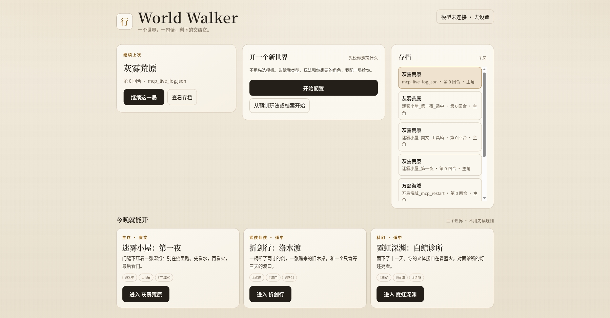
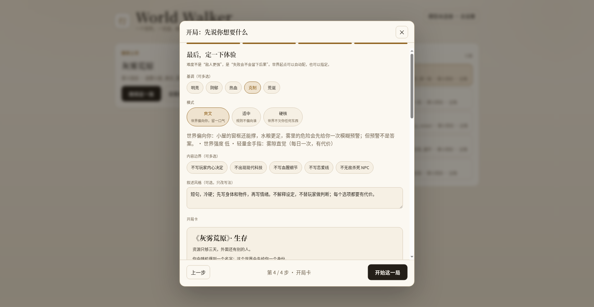
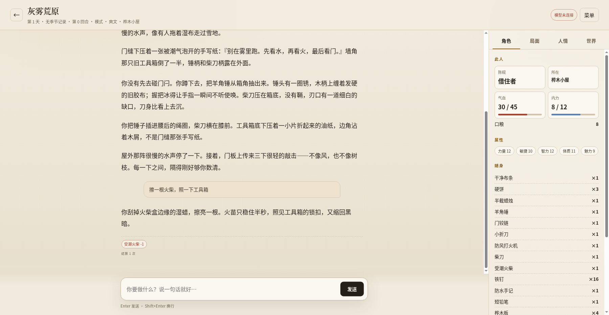

# World Walker

**v1.18.0** · [English](README.md) · **简体中文** · [架构](ARCHITECTURE.md) · [MCP 模式](docs/MCP_PLAY.md) · [更新日志](CHANGELOG.md)

World Walker 是一个单人 AI 跑团引擎。你用日常语言和 GM 对话，判定、价格、背包、关系、存档与回放由确定性规则引擎负责；故事由任何 OpenAI-compatible `/chat/completions` 端点来写。

不用宿主 App，不绑定模型厂商。AI 写场面，引擎管事实。

`221 个规则函数` · `73 个 MCP 工具` · `28 个玩家工具` · `7 套设定包` · `9 套模板` · `24 个可执行自检` · `0 个运行时依赖`

## 界面

| 大厅 | 知识库 | 模式选择 | 对局 |
| --- | --- | --- | --- |
|  |  |  |  |

## 它解决什么

多数 AI 跑团会坏在同样的地方。World Walker 把这些边界写进引擎，而不是写进更长的提示词。

- **GM 不能替你玩。** 它只写世界和 NPC；你的决定始终由你来做。
- **NPC 只知道亲眼见过的事。** 角色不能引用自己没见证过的事实。
- **一回合必须留下痕迹。** 每次回复都有场面卡和审计；没有可见后果的回合会被标出来。

战役是玩出来的，不是预写的。开局先问类型、玩法、角色、基调、模式（爽文/适中/硬核）和边界；之后每一回合走 `场面卡 → 你的行动 → 世界反应 → 状态变化 → 下一个钩子`。

## 安装与开玩

```bash
pip install -e ".[mcp]"      # 核心只用标准库；mcp 是可选依赖
wg init my-game.json
wg play --state my-game.json
```

`wg play` 会打开本地页面 `http://127.0.0.1:8899/`。可以继续旧局，也可以开新世界。玩家界面只有一屏：左边是叙事，右边是窄栏（角色、任务、人情、世界），底部一个输入框。

`wg` 是统一入口：`init`、`setup`、`play`、`serve`、`mcp`、`run`、`doctor`、`version`。完整列表见 `wg --help`。

`wg setup` 会把五个内置叙事技能、导演备注和两条桌面规则写入 `~/.world-walker/harness.json`，权限 `0600`；已有配置不会覆盖，`--force` 才重写。

## 知识库与预制玩法

大厅的“从预制玩法或档案开始”里有两套可直接选择的入口：万岛海域·海岛求生，以及灰雾荒原的迷雾小屋。每个世界都可以选三种模式：**爽文**（世界偏向你，起始资源更足、压力更慢；加成全是可清点的实物或体力，能数、会用完、会被抢）、**适中**（不送不坑，按世界规则走）、**硬核**（资源更紧、压力钟更快、死亡不可复活）。迷雾小屋的爽文模式给一套旧五金工具箱：4块60×15cm木板、16枚3cm钉、1副门铰链、1卷10米承重40kg尼龙绳、1只机械温湿度计、1只约80次点火的防风打火机、1把500g羊角锤、1把28cm柴刀；外加搬货练出的力气，力量12（普通成年男性10），能肩扛60kg走20米。每件都会损耗、会被抢，柴刀连砍20次会卷刃。硬核模式无金手指、无系统、永久死亡。预制包只固定世界、循环、基础难度、基调和叙述风格；名字、角色、边界和之后发生什么仍由玩家决定。

“设计档案”里有救生筏、预制玩法规范和发布纪律三份底稿。数据在 `library/playbooks/*.json` 与 `library/archives/*.md`，随安装包一起分发。

### 三种模式，一套规则内核

`load_setting(path=..., mode="power")` 接受 `power`（爽文）、`balanced`（适中）、`hardcore`（硬核）。模式会改变起始体力/物资、市场温度、初始压力钟和 GM 的叙事规则；世界自己的 `modes` 块负责命名它专属的那一点“金手指”。爽文是**有代价的轻量优势**，不是无限引擎；同一套三档预设对每个设定包和模板都生效。

## 用你自己的模型

模型层只假设一个 OpenAI-compatible 端点：

```json
{ "base_url": "https://你的网关/v1", "api_key": "sk-...", "model": "任意模型" }
```

在页面的模型设置里填写，或使用 `WW_MODEL_BASE_URL`、`WW_MODEL_API_KEY`、`WW_MODEL_NAME`。配置保存在 `~/.world-walker/model.json`，权限为 `0600`。

## 调校 GM

面板右上角的“连接与调校 → 叙事调校”把四层分开，避免把叙事偏好、提示词包和确定性规则混成一个万能开关：

- **提示词**：导演备注和桌面规则追加到 GM 系统提示；它们改口味，不覆盖 POLICY、CANON 和数值结算。
- **叙事技能**：`narrative_skills/*.md` 里的提示词包，带标题和摘要，按需注入；不是角色技能。
- **引擎规则**：当前存档的 `rulebook`，按 `order` 执行，效果走白名单；可在面板里校验并写入，触发次数会落盘。规则可在回合开始或每次工具结算后执行。
- **回合钩子**：`~/.world-walker/hooks` 下的 `before_turn.py`、`after_tool.py`、`after_turn.py`。默认关闭；脚本以你的权限运行，等同你亲手执行这段 Python。

调校配置保存在 `~/.world-walker/harness.json`，权限为 `0600`。外部 Agent 的 prompt、skill、hook、rule 仍由宿主自己配置；World Walker 只提供 MCP 工具和开局提示词。

## 通过 MCP 接入 agent

```json
{ "mcpServers": { "world-walker": { "command": "world-walker-mcp" } } }
```

任何 MCP 客户端都能接。远程 agent 可以用 HTTP，不必走 stdio：

```bash
wg mcp --http --port 8620
```

然后把客户端指向 `http://127.0.0.1:8620/mcp`。一套设定包加一次交易，就能开始一局完整的游戏：

```
load_setting(path="settings/玄枢界.setting.json")
trade(location="临川城", item="ningyuan_dan", direction="buy", quantity=1)
```

宿主只在需要数字时调用工具，正文留在对话里。

## 引擎管什么

- **判定与战斗：** d20、2d6、d100、4dF、骰池、对抗判定、伤害与死亡规则。
- **经济与人：** 价格、背包、关系、声望、债务与势力变化。
- **世界推进：** 钟、传闻、游走 NPC、线索、事业线阶段与长局后果。
- **回放：** 单一事务写入源、带状态指纹的动作日志、可检查的存档。
- **上下文边界：** NPC 知情范围、canon 事实、世界书触发，以及每次回复前的场面卡。

玩家界面只暴露 28 个工具；73 个 MCP 工具留给高级宿主。两条入口共用同一套规则、存档与写入源。

## 质量

验证是用来失败的，不是用来好看的。`scripts/verify_*.py`、行为回归和变异测试都会在代码被改坏时变红。主门禁跑 24 个可执行自检，核心域有覆盖率要求，变异测试要求零存活。

```bash
python3 scripts/verify_docs.py
python3 scripts/verify_player_shell.py
python3 scripts/verify_mcp_stdio.py
```

## 存档与故障

存档使用原子替换和 `.bak` 降级，并带 Windows/POSIX 可重入锁。崩溃测试覆盖多个中断窗口。

如果存在 `<state>.archive-pending` 或 `.ww-session-transaction-pending`，受保护的读写会被拒绝。这里**不会自动恢复**：请停止写入、保留现场并人工核对。保存失败后恢复调用方内存中的状态对象，**不等于磁盘归档回滚**。详见[归档人工恢复指南](docs/ARCHIVE_RECOVERY.md)。

## 项目范围

面向单人 AI GM、设定包、本地存档和 MCP 宿主。明确不做多人联机、云端账号、插件市场，也不把预写战役当内容售卖。

## 项目结构

```
world-walker/                  # 仓库根即 game_engine 包
├── panel.py                   # 玩家 HTTP/SSE 服务与游戏 API
├── dialog_runtime.py          # GM 提示词、工具循环、回合收尾与审计
├── narrative_rules.py         # Session Zero、场面卡、回合审计
├── rules/                     # 确定性结算
├── settings/                  # 七套可直接开玩的世界
├── saves/                     # 本地存档库
└── scripts/                   # 验证与构建工具
```

## 许可

MIT。演示包里的人物、势力与地名均为原创，不复用任何现有作品的名词与设定。
