# World Games

**v1.10.0** · [English](README.md) · **简体中文** · [架构](ARCHITECTURE.md) · [拿它做什么](docs/USE_CASES.md) · [玩法层](docs/GAMEPLAY.md) · [对标调研](docs/BENCHMARK.md) · [先贤调研](docs/PRIOR_ART.md) · [更新日志](CHANGELOG.md) · [展示站](https://badhope.github.io/world-walker/)

> **AI 负责叙述，引擎负责结算。**

World Games 是 AI 互动游戏的规则层。你的 Agent 负责写文字，确定性引擎负责结算每一次命中、
价格、关系与势力变化，并写进同一份可审计的状态文件。

`206 个规则函数` · `67 个 MCP 工具` · `4 套可玩世界` · `8 套游戏模板` · `0 个运行时依赖`

<p align="center">
  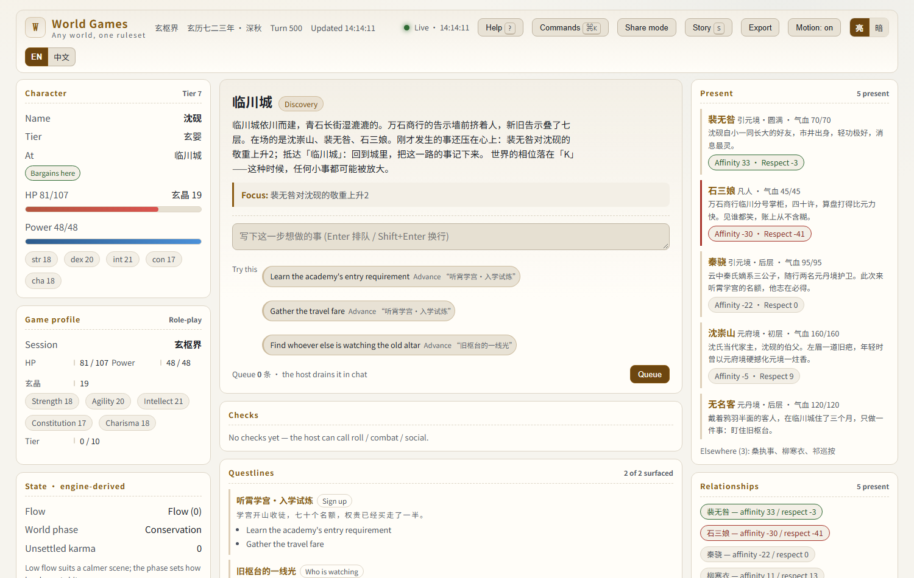
</p>

<p align="center">
  <a href="docs/screenshots/walkthrough.mp4">▶ 16 秒真实对局录屏</a>
</p>

<p align="center">
  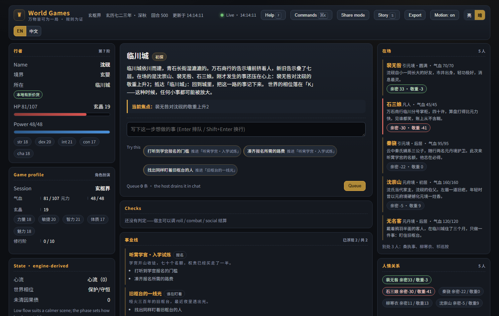
</p>

<p align="center">
  <sub><b>默认亮色</b>——主舞台是要长时间读的。暗色在顶栏一键切换，选择会被记住。
  两套配色都由 <code>verify_theme.py</code> 在真实浏览器里实测 WCAG AA 对比度，不靠肉眼。</sub>
</p>

---

## 它解决什么

长局 AI 游戏通常死于三个问题，World Games 用代码解决，而不是靠提示词措辞。

| 问题 | 常见情况 | World Games 的做法 |
|---|---|---|
| 数值漂移 | 模型自己编伤害、价格、血量 | **规则函数**结算；相同状态 + 种子 + 行动序列逐字节可复现 |
| AI 遗忘 | 上下文窗口溢出，旧事实消失 | **上下文台账**把线索、承诺、事实落盘；`context_pack` 按预算取回 |
| 存档失控 | 单个 JSON 手工管理 | **存档库**：多局、快照、回收站，统一由 `session_*` 管理 |

还有两件多数框架不做的事：

- **世界自己会动。** 每次 `tick` 推进势力（logistic 增长 + Lotka–Volterra 压制）、
  谣言（SIR）、风气（Deffuant）、游荡 NPC，以及由真实存量驱动的 Panarchy `r → K → Ω → α` 循环。
  不调用 `tick`，世界就静止——这是设计，不是缺陷。
- **面板严格只读，且双语。** 本地网页主舞台渲染真实状态，默认英文，一键切中文，从不写入。玩家可以把行动排进侧写文件，
  宿主用 `pending_actions` 取走后照常结算。只有一个写入源，才谈得上确定性。

---

## 安装

```bash
pip install -e ".[mcp]"      # 核心仅标准库；mcp 是 MCP 模式的可选依赖
```

接入任意 MCP 客户端（Claude Code / Codex / Cursor / opencode）：

```json
{ "mcpServers": { "world-games": { "command": "world-games-mcp" } } }
```

`world-walker-mcp` 仍作为兼容别名可用。

远程 agent 也可以走 HTTP 接入，不必经 stdio：

```bash
wg mcp --http --port 8620   # 客户端连 http://127.0.0.1:8620/mcp 即可
```

## 开一局

```
load_setting(path="settings/玄枢界.setting.json")
```

这就是一局完整游戏：世界、主角、NPC、市场、关系、等级阶梯、世界书、事业线、体系全在里面。

然后开始玩。需要数字时由宿主调用工具：

```
你：我走进万石商行，把《引元诀》残页拍在柜台上。

Agent → trade(location="临川城", item="ningyuan_dan", direction="buy", quantity=1)
      → social(actor="player", target="shi_sanniang", event="cooperate")
      → narration_context(scene_text="万石商行")
      → publish_prose(text="……")
      → tick()
```

没有 MCP 客户端？命令行用的是同一套引擎：

```bash
python init_game.py
python engine.py world_state --state game_state.json
python engine.py combat --state game_state.json --attacker player --defender goblin --action_type heavy
python panel.py --state game_state.json     # 打开只读主舞台
```

## 玩一局不是修仙的游戏

不需要设定包，自己定义档案即可：

```
session_new(name="我的团")
game_profile({title:"调查", kind:"investigation",
              resources:[{key:"sanity", label:"理智", value:8, min:0, max:10}],
              meters:[{key:"clue", label:"线索", value:0, min:0, max:12}]})
roll(attribute="per", difficulty=12, dice="2d6", reason="翻查档案")
context_remember("门房说昨夜灯塔亮过", kind="clue", keys=["灯塔"])
context_pack(scene_text="灯塔")
```

或者从模板起步：

```
template_start(template="mystery", name="我的调查局",
               overrides={"world": {"name": "雨港"}})
```

---

## 界面

下面每一张图都是真实存档的真实渲染，由 `scripts/shots.py` 在 Edge 中逐项断言后拍摄。
来源存档见 [`docs/demo/`](docs/demo/)。

| 玄枢界 · 东方玄幻 · 墨金 | 折剑行 · 武侠 · 水墨 |
|---|---|
|  | 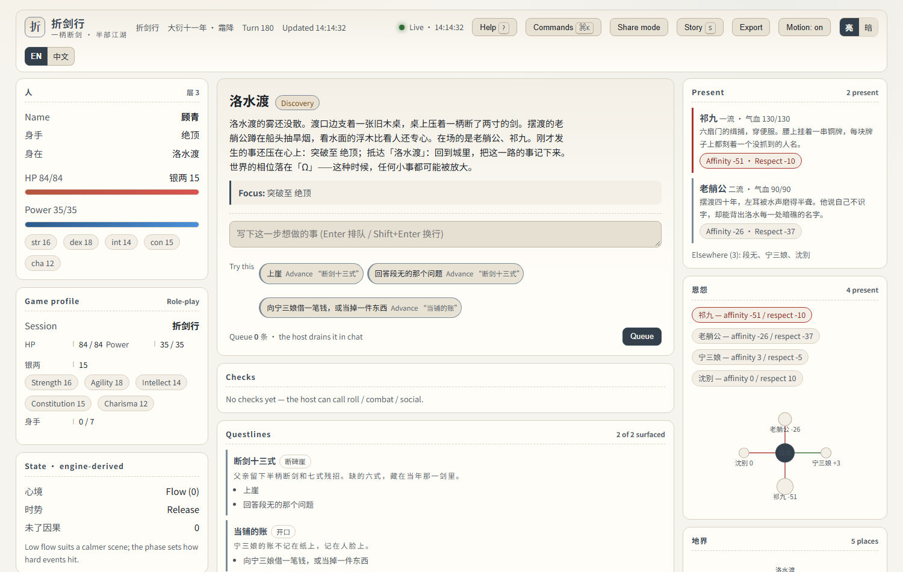 |
| **霓虹深渊 · 赛博朋克 · 霓虹** | **雾港 · 调查悬疑 · 石墨** |
| 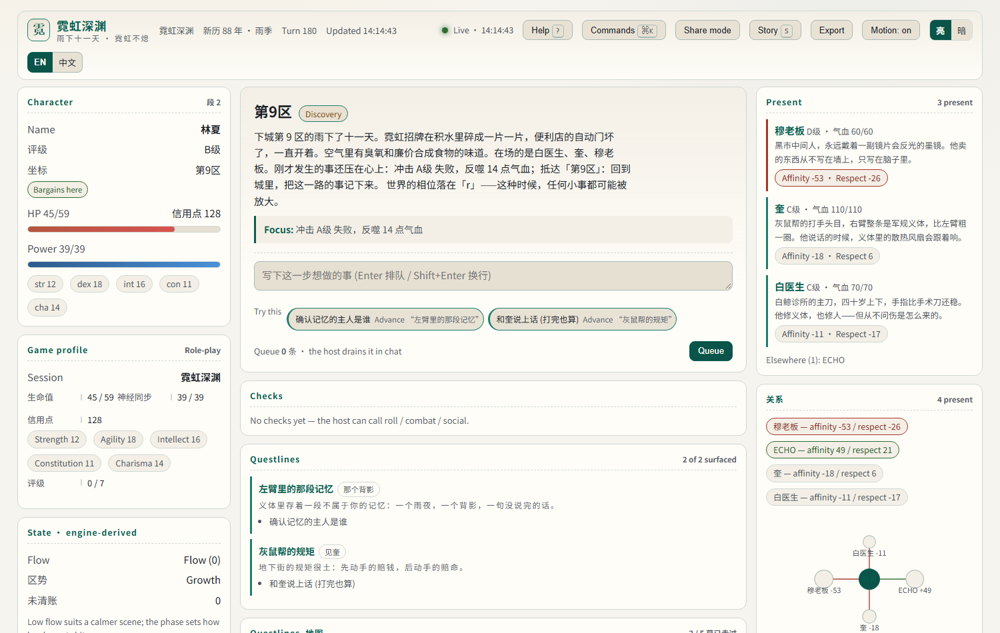 | 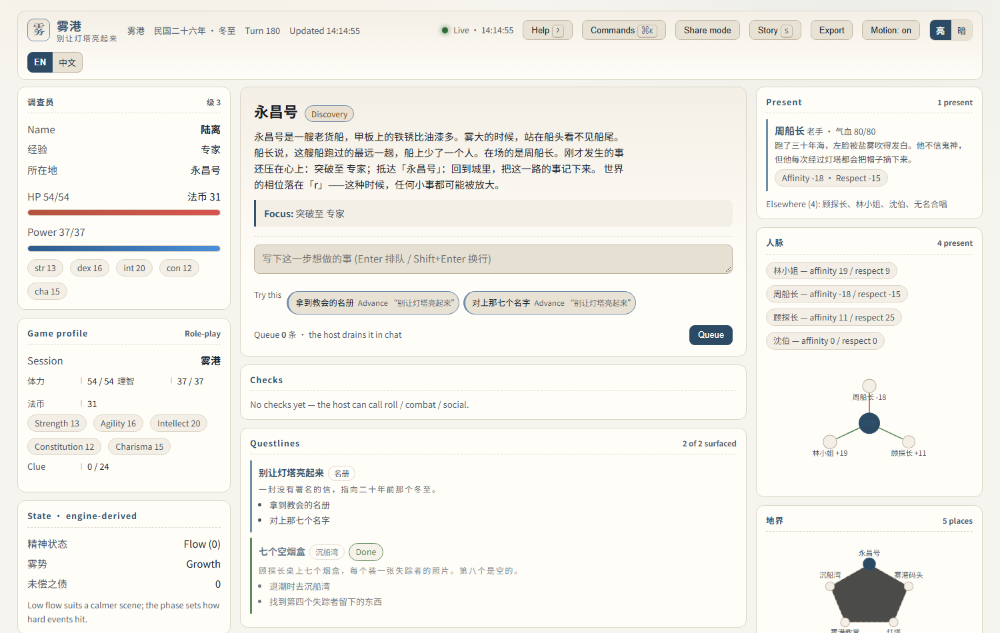 |

皮肤只是表层。真正随世界改变的是**词、阶、钱、地点描写**：设定包里写
`terms: { level: "身手", gold: "银两" }`，面板上就不会再出现"境界 / 灵石"。
`scripts/verify_settings.py` 会逐个世界断言这件事。

| | |
|---|---|
| 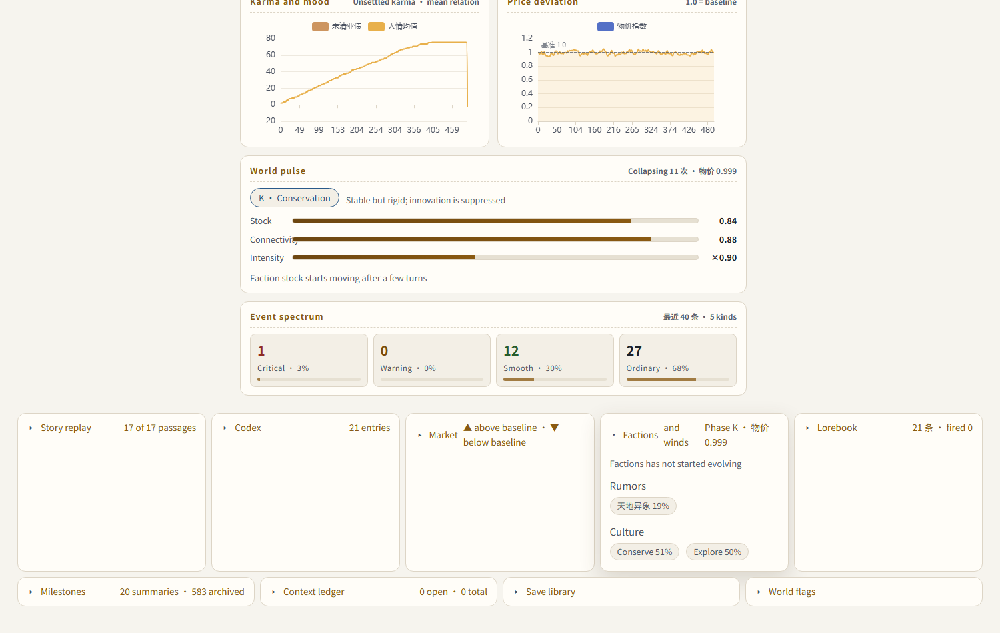 | 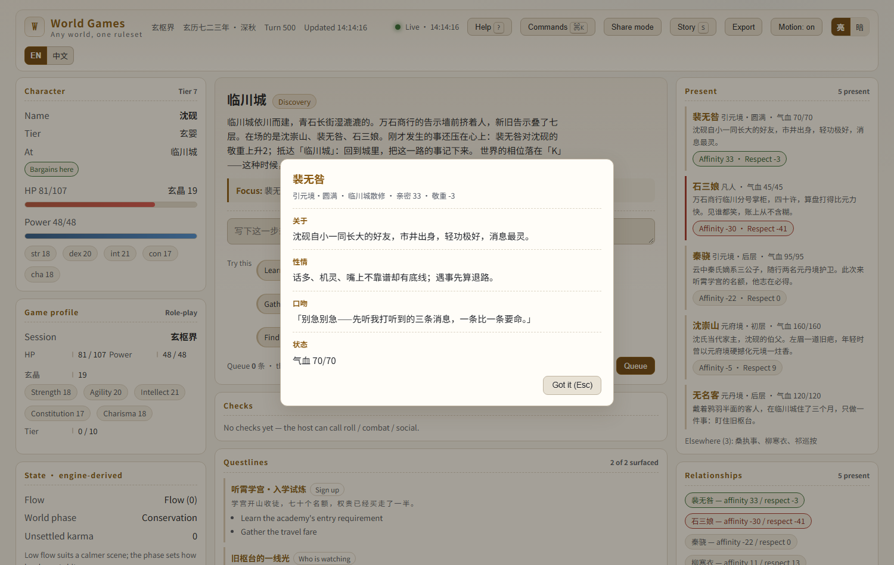 |
| **世界脉搏**：Panarchy 相位、势力存量、连接度、烈度、谣言热度，由 `tick` 每回合推动 | **角色卡**：点开在场人物，读卡面文字 |
| 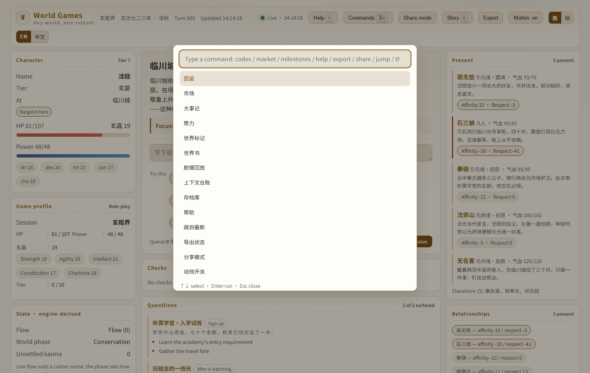 | 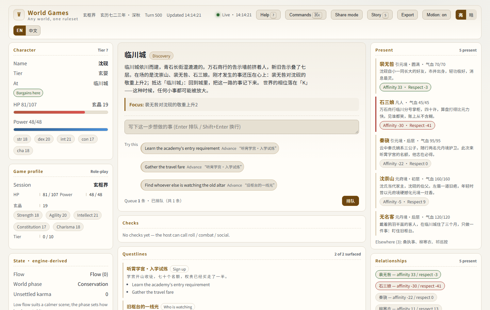 |
| **命令面板**（`Ctrl/⌘+K`），全键盘可达 | **行动队列**：浏览器里排队，宿主用 `pending_actions` 取走结算 |

| 图鉴 | 市场 | 大事记 |
|---|---|---|
| 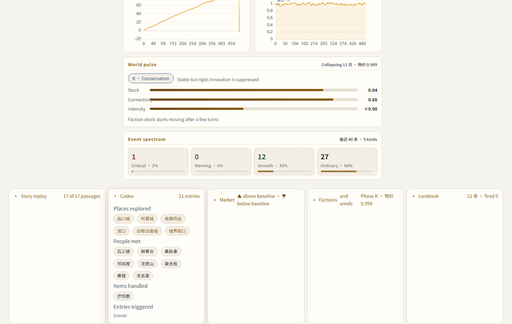 | 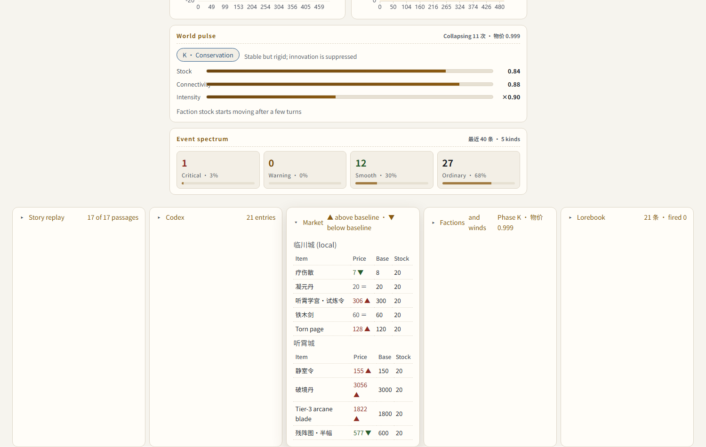 | 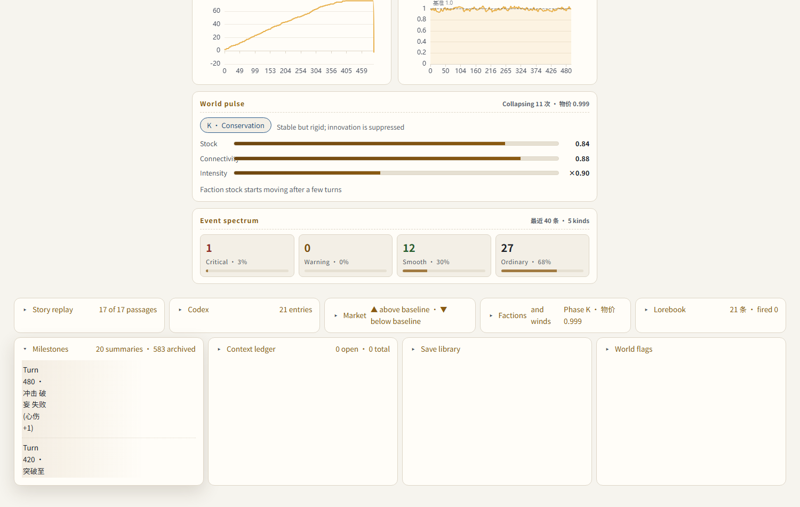 |

| 768px | 320px | 帮助 |
|---|---|---|
| 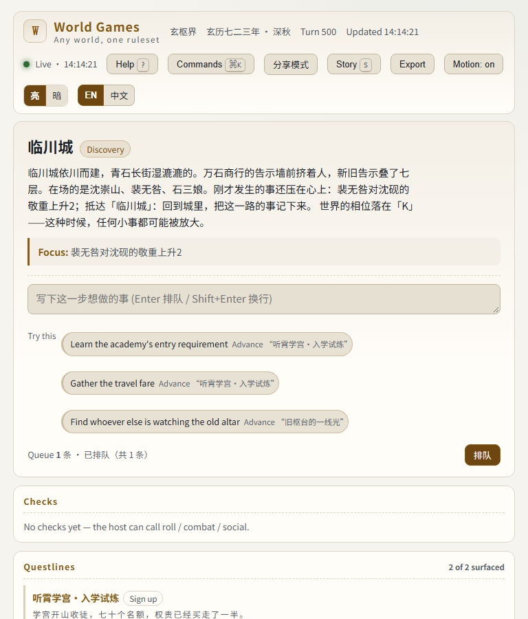 | 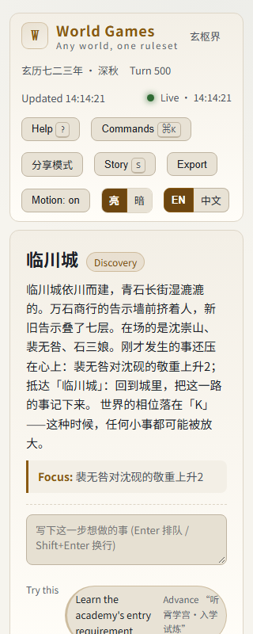 | 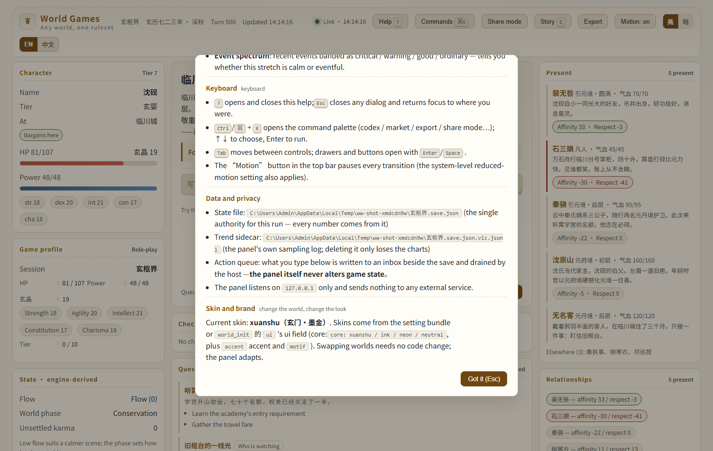 |

| 分享模式（隐藏路径与操作区） | 首次访问引导 |
|---|---|
| 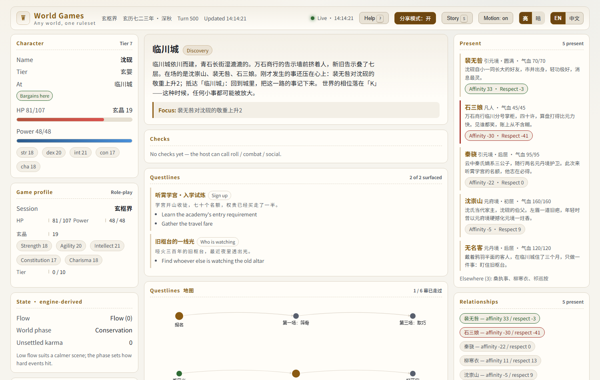 | 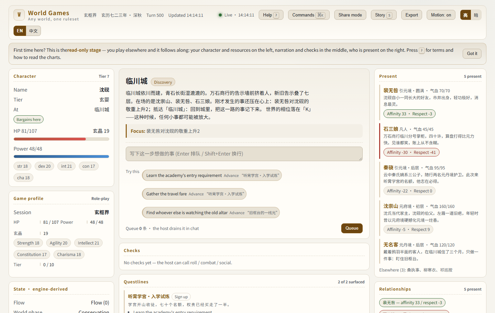 |

---

## 67 个工具

| 分组 | 工具 |
|---|---|
| 开局与存档（9） | `session_new` `session_list` `session_switch` `session_snapshot` `session_manage` `session_import` `load_setting` `world_init` `world_open` |
| 每回合核心（5） | `pending_actions` `context_pack` `narration_context` `publish_prose` `tick` |
| 判定与数值 | `roll` `combat` `combat_preview` `trade` `social` `karma` `advance` `use_item` `game_profile` `game_adjust` `game_tag` `game_sheet` |
| 世界与位置（9） | `travel` `world_state` `narrative` `status` `playbook_info` `quest_status` `quest_advance` `lore_lookup` `failure_tick` |
| 记忆与检索 | `context_remember` `context_known` `context_tell` `context_search` `context_forget` `recall` `write_summary` `recap` `read_state` |
| 体系与模板（9） | `templates_list` `template_info` `template_apply` `template_start` `system_define` `system_remove` `system_run` `system_status` `system_schema` |
| 生态与工具（13） | `character_card_read` `add_character` `import_lorebook` `spawn_npc` `model` `model_list` `merit` `narrative_weight` `snapshot` `restore` `configure` `open_panel` `close_panel` `world_schema` |

完整参数与调用约定见 [GAME_MASTER_PROTOCOL.md](GAME_MASTER_PROTOCOL.md)。

---

## 一回合，完整流程

真实返回值，来自雾港调查包。

**玩家**：我去码头问门房，灯塔最近有没有亮过。

```
1. context_pack(scene_text="码头 灯塔 门房")
   → 玩法（choice · 线索 0/24）、未结案线索、最近事件

2. roll(attribute="per", difficulty=9, dice="2d6", reason="向门房打听灯塔")
   → {"rolls":[1,1], "total":2, "difficulty":9, "margin":-7, "level":"failure"}

3. context_remember("门房说昨夜灯塔亮了三分钟，随后灭了",
                     kind="clue", keys=["灯塔","门房"], source="门房")
   → {"fact":{"id":"f0001", ...}, "created":true}

4. game_adjust("clue", delta=1)   → {"after":1, "at_max":false}
   game_adjust("sanity", delta=-1) → {"after":7, "at_min":false}

5. publish_prose("雨没停。门房把烟摁在窗台上，说昨夜灯塔亮了三分钟。")
6. tick()  → 世界演化一回合
```

全部落在同一份状态文件里：判定在 `checks`、事实在 `context.facts`、资源在 `game`、
正文在 `prose`、世界在 `panarchy/factions/...`。面板只读这些字段，别的不碰。

---

## 体系与模板

### 七类可插拔体系

玩法机制是**数据**，不是代码。运行时随时增删。

| 体系 | kind | 管什么 | 动作 |
|---|---|---|---|
| 时间 | `time` | 日/时/分、季节、天气 | `advance(minutes)`、`status` |
| 掉落 | `loot` | 加权掉落表、数量区间、空掉落 | `roll(table, times, grant)`、`list` |
| 制造 | `craft` | 配方、材料校验、技能判定、失败返还 | `craft(recipe)`、`list` |
| 声望 | `reputation` | 势力声望 −100..100 + 分档 | `adjust(faction, delta)`、`status` |
| 成就 | `achievement` | 条件（复用事业线谓词）+ 奖励 | `check`、`list` |
| 成长 | `progression` | XP 曲线、等级、每级属性成长 | `grant(amount)`、`status` |
| 自定义 | `custom` | 受限效果列表（资源/属性/进度轨/标签/事实/声望/XP/时间/掉落） | `<动作名>`、`list` |

全部**确定性**：时间/掉落/制造的随机都由 `sha256(seed|tick|...)` 派生，不消耗 `rng_counter`。
运行态写进 `state["systems"]["rt"]`，快照回退会连体系一起回退。

### 八套开箱即用的模板

| 模板 | 题材 | 玩法循环 | 体系数 |
|---|---|---|---|
| `jrpg` | 日式奇幻冒险 | freeform | 7 |
| `mystery` | 本格推理调查 | choice | 5 |
| `management` | 店铺经营 | mud | 4 |
| `survival` | 末日生存 | mud | 4 |
| `narrative` | 情感叙事 | freeform | 4 |
| `cozy` | 田园生活 | freeform | 4 |
| `tabletop` | 桌面跑团 | ttrpg | 5 |
| `immersive` | 沉浸模拟 | ttrpg | 4 |

模板是起点不是锁死：`overrides` 深合并 dict、列表整体替换；
`template_apply` 只返回 bundle 不落盘。

---

## 四种玩法循环，同一套规则

`playbook` 描述一局游戏怎么玩，并为宿主提供叙事指引。

| 字段 | 可选值 | 作用 |
|---|---|---|
| `loop` | `freeform` / `choice` / `mud` / `ttrpg` | 自由推进 / 选项推进 / 地点命令 / 声明→判定→后果 |
| `input` | `natural` / `choice` / `command` | 玩家输入形态 |
| `progress` | `{axis, label, max}` | 进度轴：`level` / `gold` / `reputation` / `knowledge` / `clock` |
| `failure` | `{mode, label, max}` | 失败条件：`hp` / `sanity` / `clock` / `deadline` / `none` |
| `beat` | `{pattern, every}` | 节拍序列，如「日常·摩擦·升级·代价·回收」 |
| `context` | `{inject, max_lore, scan_depth}` | 每回合上下文注入策略 |

循环是给宿主的指引，不由引擎强制执行。失败不等于扣血——债主上门、被人盯上、理智耗尽
都是可配置的失败条件，由 `failure_tick` 推进。

四套设定包分别演示四种循环：玄枢界 `freeform`、折剑行 `ttrpg`、霓虹深渊 `mud`、雾港 `choice`。

### 事业线

事业线是 stage DAG，谓词只读世界状态：

```json
{
  "id": "fog_lighthouse",
  "title": "别让灯塔亮起来",
  "visibility": {"flag": "无署名信"},
  "stages": [
    {"id": "letter", "title": "信", "objectives": ["弄清信是谁写的"],
     "exit_if": {"visited": "雾港码头"}, "next": ["keeper"]},
    {"id": "keeper", "title": "看守", "objectives": ["找到沈伯"], "next": []}
  ],
  "reward": {"flags": ["灯塔真相"]}
}
```

- **谓词：** `flag` / `visited` / `gold_gte` / `karma_gte` / `tier_gte` / `relation_gte` / `item_gte` / `counter_gte` / `stage_done`，支持 `all` / `any` / `not` 组合。
- **dormant 不显示** —— 没满足 `visibility` 的事业线不进面板，避免变成待办清单。
- **只有 `exit_if` 才推进** —— 没有它的一幕永不自动往前跑；由宿主调用 `quest_advance`。
- **失败优先** —— `fail_if` 或 `deadline_tick` 命中直接判失败。
- **奖励只发一次** —— 完成后反复 tick 不会重复给钱。
- 载入时校验 DAG：有环、`next` 指向不存在的 stage 一律报错。

### 世界书

与 SillyTavern 语义对齐，但逐回合确定性：

| 语义 | 状态 |
|---|---|
| `keys` / `secondary_keys` / `selective` | 支持 |
| `selectiveLogic` 四值（AND_ANY / NOT_ALL / NOT_ANY / AND_ALL） | 支持 |
| `constant` / `insertion_order` / `enabled` | 支持 |
| `probability` / `use_probability` | 支持，由 `sha256(seed|tick|entry)` 派生 |
| `sticky` / `cooldown` / `delay` | 支持，按 tick 计，写进状态 |
| `group` / `group_weight` / `group_override` | 支持，同组只出一条 |
| `scan_depth` / `match_whole_words` / `exclude_recursion` | 支持 |
| 递归扫描 | 支持，但**默认关闭** |
| `position` / `depth` / `role` / `outlet` | 不支持 —— 提示词布局属于宿主 |
| `vectorized` / `automationId` / `characters` 过滤器 | 不支持 —— 需要嵌入模型或前端脚本 |

面板「世界书」抽屉显示每条设定的触发次数与 sticky/cooldown 剩余，
用来回答"为什么这一段被触发了"。`lore_lookup` 可以按任意文本预演一次触发，
不写状态也不消耗冷却。

### 设定包

一个 JSON 就是一个世界。格式说明：[settings/README.md](settings/README.md)。

| 设定包 | 类型 | 特色 |
|---|---|---|
| [`玄枢界`](settings/玄枢界.setting.json) | 东方玄幻 | 十阶修行、玄晶经济、八股势力、21 条世界书 |
| [`折剑行`](settings/折剑行.setting.json) | 武侠 | 七阶身手、断剑主线、当铺经济 |
| [`霓虹深渊`](settings/霓虹深渊.setting.json) | 赛博朋克 | F–S 评级、信用点、义体与记忆、雨季氛围 |
| [`雾港`](settings/雾港.setting.json) | 调查悬疑 | 六阶调查、理智/体力、灯塔谜题 |

`scripts/verify_settings.py` 对每个包断言：载入完整、术语覆盖生效且无未声明的外来词、
货币与品牌落盘、地点描写生效、连跑 15 回合后势力与相位都在动。

---

## 项目范围

**在范围内：** 规则结算、设定包、存档、上下文台账、宿主叙事指引、
SillyTavern 角色卡（PNG/JSON，V1–V3）与世界书。

**明确不做：** 图像生成、多人联机、云端账号体系、插件市场。
这些是取舍不是遗漏，理由写在 [ROADMAP.md](ROADMAP.md)。

---

## 质量

项目没有 pytest 套件，这是设计选择。验证由 `scripts/verify_*.py`、行为回归和变异测试组成：
**断言必须能被杀死，而不是只被覆盖率统计到。**

| 自检 | 断言数 | 锁住什么 |
|---|---|---|
| `verify_formulas.py` | 122 | 按 docstring 的数学式独立重算 77 个函数 |
| `verify_branches.py` | 192 | 低覆盖模块的异常路径与状态分支 |
| `verify_cli.py` | 21 | CLI 只读不变量 / 写命令业务效果 / 双通道确定性 / tick 驱动世界 |
| `verify_panel.py` | 98 | 视图模型契约 / 旧存档兼容 / 静态白名单 / 行动队列三道闸 / 主题接线 |
| `verify_mcp_stdio.py` | 67 | 真实 stdio 端到端 / HTTP 传输握手 / 酒馆生态 / 只读零副作用 |
| `verify_world.py` | 54 | 世界自演化 / 相位 / 心流 / 道德 / 术语 / 正文 / 台账 |
| `verify_settings.py` | 17 | 四套世界观的载入与演化（零依赖路径） |
| `verify_docs.py` | — | 版本单一信源 / 工具数 / 断言计数 / 素材引用 |
| `verify_i18n.py` | 12 | 面板词典：键唯一 / 模板无歧义 / 输出无中文 / 双语接线 |
| `verify_mechanics.py` | 39 | 规则书优先级与截断 / 循环检测 / NPC 知识边界 / 战斗推演 / 事业线 DAG / 访问计数 / 前缀哈希 / 谣言热度 / 势力意向 |
| `verify_theme.py` | 25 | 亮色默认 / 两套主题实测 WCAG AA 对比度 / 图表重绘 / 骨架屏 |
| `verify_replay.py` | 15 | 动作日志链 / seq 落盘 / canonical 哈希 / 确定性指纹 |
| `verify_gameplay.py` | 65 | 玩法剧本 / 事业线 DAG / 世界书语义 |
| `verify_generic.py` | 104 | 通用判定 / 游戏档案 / 上下文台账 / 存档库 / 品牌 |
| `verify_systems.py` | 161 | 七类体系 / 八套模板 / 计数器 / 面板契约 |
| `verify_injection.py` | 23 | 注入特征识别与 `untrusted` 标记 |
| `verify_near_death.py` | 7 | 濒死保护 |
| `verify_audit_fix.py` | 22 | 快照恢复 / 并发读改写 / 严格 JSON / 输入边界 / 只读零副作用 |
| `verify_memory.py` | 7 | 三段对照查泄漏 + 三重有界 |
| `user_playtest.py` | 47 | 玩家视角：卖没有的东西 / 超量交易 / 边界输入 / 报错可读性 |
| `smoke_ui.py` | 20 | 真实 Edge 渲染 / 卡片抽屉 / 响应式 / 零 JS 错误 |
| `verify_tests.py` | — | 静态 AST：拒绝恒真/恒假/弱断言 |
| `verify_mutation.py` | 53 个变异 | **故意改坏代码，确认测试会红**；存活率必须为 0% |

```bash
bash scripts/pre_push_gate.sh     # 28 个步骤；缺必要依赖时门禁失败
```

另有两套端到端压测：`stress_freeplay.py 500`（CI）与 `stress_freeplay.py 2000`（本机），
全程走真实 MCP stdio。最近一次 500 轮：0 意外错误、0 不变量破坏。

覆盖率门禁：核心域 ≥70%（实测 86%，含通用游戏层）；`pyflakes` 0。
`bandit` 在引擎核心为 0；仓库级扫描仍会在测试脚本里报低危项。

---

## 项目结构

```
world-walker/                  # 仓库根即 game_engine 包
├── engine.py                  # CLI，14 条命令
├── mcp_server.py              # MCP 服务器，67 个工具
├── state_schema.py            # 状态模型 / 原子写 / 事务锁 / 世代归档 / 种子
├── panel.py                   # 只读视图模型 + HTTP/SSE + 行动收件箱
├── panel.html / .css / .js    # 主舞台：原生三件套，无构建链
├── viz_series.py              # 长局态势侧写（<state>.viz.jsonl）
├── sessions.py                # 存档库：多局 / 快照 / 回收站
├── rules/                     # 206 个公开规则函数
│   ├── checks.py              # d20/2d6/d100/4dF/骰池、对抗、成功等级
│   ├── gamesystem.py          # 游戏档案：自定义属性、资源、进度轨、标签、表格
│   ├── context.py             # 上下文台账：线索、承诺、事实 + 预算打包
│   ├── combat.py economy.py social.py karma.py
│   ├── cognition.py narrative_engine.py progression.py
│   ├── world_dynamics.py world_evolution.py
│   ├── models.py              # 16 个命名闭式模型
│   └── social_extended.py cultural_evolution.py systems_feedback.py
├── settings/                  # 4 套可直接开玩的设定包
├── scripts/                   # 22 个自检 + 变异测试 + 截图/视频/演示存档流水线
├── docs/demo/                 # 真实演示存档（截图背后的数据）
├── docs/screenshots/          # 逐项断言后的真实渲染
└── assets/echarts.min.js      # 离线图表库（Apache-2.0，随包分发）
```

---

## 常见问题

**需要联网吗？**
不需要。核心与面板零第三方依赖，图表库本地随包分发。只有 MCP 模式要装 `mcp` SDK。

**需要 OpenAI / Claude 的 API Key 吗？**
不需要。它从不调用模型；模型由你的 Agent 提供，引擎只决定"世界怎么变"。

**能用于商业项目吗？**
MIT 许可。演示包里的人物、势力、地名全部原创，可自由替换。

**为什么不用 pytest？**
断言必须经得起"改坏代码看测试红不红"的检验。`verify_tests.py` 静态拒绝恒真断言，
`verify_mutation.py` 注入 50 个真实缺陷并要求全部被杀。两者都在门禁里。

**为什么面板不能直接提交行动？**
可以排队，但不直接结算。面板写 `<state>.inbox.jsonl`，Agent 用 `pending_actions` 取走，
再走引擎结算。这样才只有一个写入源，确定性与快照回退才可信。

**保证断电安全吗？**
不保证，我们也不这样宣称。存档使用原子替换 + `.bak` 降级 + Windows/POSIX 可重入锁，
崩溃测试覆盖多个中断窗口。若存在 `<state>.archive-pending` 或 `.ww-session-transaction-pending`，
相关受保护读写会被拒绝，且不会自动恢复——请停止写入、保留现场并人工核对。
保存失败时恢复调用方内存中的状态对象，不等于磁盘归档回滚。
详见[归档人工恢复指南](docs/ARCHIVE_RECOVERY.md)。

---

## 重新生成演示素材

```bash
python scripts/make_demo.py          # 4 套世界的真实演示存档 → docs/demo/
python scripts/shots.py              # 逐项断言 + 截图 + 录屏 → docs/screenshots/
python scripts/verify_settings.py    # 四套设定包全量校验
```

---

## 许可

MIT。图表库 [ECharts](https://echarts.apache.org/) 5.5.1（Apache-2.0）。
酒馆生态格式的兼容实现参考了 SillyTavern 社区公开的角色卡与世界书规范；
本项目不复用任何作品的名词与设定。
